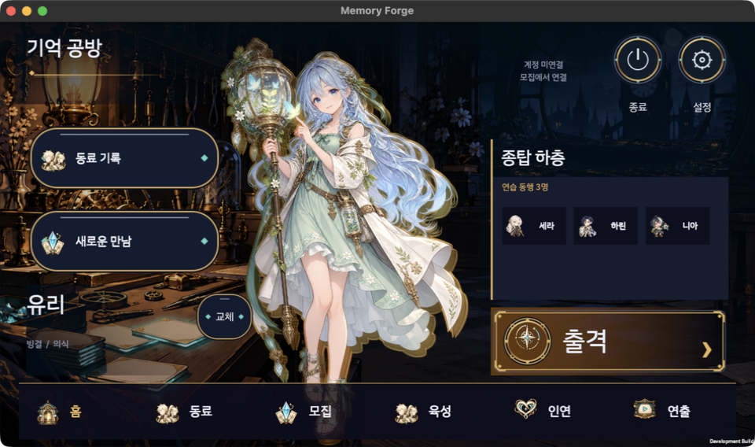

# 기억 공방 · Memory Forge

[](https://github.com/choijunhuk/memory-forge-rpg/actions/workflows/ci.yml)

**동료를 만나고, 카드를 벼리고, 탐사의 변화를 기억으로 남기는 서브컬처 덱빌딩 RPG.**

Unity 6 기반 모바일 게임을 개발하고 있습니다. 동료 수집과 편성, 턴제 카드 전투, 성장·장비·지원 파트너를 하나의 플레이 흐름으로 연결하며, macOS 개발 빌드에서도 플레이할 수 있습니다.



*2026-10-23 macOS 개발 빌드 실제 화면. 계정 미연결 상태의 연습 편성입니다.*

## 플레이 흐름

**공방 홈 → 동료 모집·편성 → 탐사와 카드 전투 → 기억 저장 → 성장·장비 → 다음 출격**

| 시스템 | 현재 구현 |
| --- | --- |
| 공방·동료 | 배경과 캐릭터 연출이 있는 홈, 동료 목록·상세, 홈 동료 교체 |
| 모집 | 개발 계정의 서버 재화 잔액·보유 동료·천장·결과 저장과 재시도 처리, 모집 연출 |
| 계정 출격 | 보유 3인 편성, 튜토리얼(현재 7층 탐사 재사용)과 1장 해금 |
| 카드 전투 | 카드 선택·효과 설명·적별 체력 예상, 필살기 컷인과 길게 눌러 엿보기 |
| 기억 | 탐사 중 생긴 카드 변화를 선택해 저장하고 다음 탐사에 사용 |
| 성장·장비 | 동료 레벨·돌파·기술, 성장 던전, 장비 강화·정련·장착, 주간 보스 |
| 지원 파트너 | 보유 파트너를 지원으로 지정하고 출전 동료의 게이지로 전투당 1회 필살기 사용 |
| 접근성 | 안전 영역 대응, 글자 크기 설정, 동작 줄이기 |

캐릭터 10명과 카드·무기·부품·유물·적·구역 데이터가 들어 있습니다. 데이터에 정의된 콘텐츠와 모든 콘텐츠의 최종 아트·음성·출시 준비 상태는 구분합니다.

**현재는 개발 빌드입니다.** 계정 기능은 로컬 Development 서버와 인증 설정이 필요합니다. 정식 회원 서비스·실결제·운영 배포는 별도이며, 웹 프로토타입은 Unity 게임과 분리된 규칙·UI 검증 도구입니다.

## 실행하기

### Unity 게임

1. Unity Hub에서 **Unity 6000.0.46f1**로 [`client/MemoryForgeUnity`](client/MemoryForgeUnity)를 엽니다.
2. `Assets/Scenes/MemoryForgeLobby.unity`를 열고 Play를 누릅니다.
3. 계정 미연결 상태에서는 연습을 이용할 수 있습니다. 실제 모집·보유 동료 출격·성장은 별도로 준비한 로컬 개발 계정을 연결해 확인합니다. 연결 화면의 서버 주소·포트를 실행한 서버 설정과 맞춥니다.

개발 계정의 서버·저장·실행기 설정은 [계정 성장 구현 안내](docs/ACCOUNT_PROGRESSION_20261021.md)와 [로컬 서버 안내](server/MemoryForge.Server/README.md)를 따릅니다. 서버 안내의 초기 연습 편성 설명은 이력이며, 최신 계정 기능 범위는 계정 성장 문서가 기준입니다. 기존 저장소는 등록된 정확한 Core 빌드에 연결되므로 임의로 바인딩을 바꾸거나 초기화하지 않습니다.

macOS 개발 빌드는 프로젝트의 `MemoryForgeDesktopBuild.BuildDev`를 사용합니다. 저장소 루트에서 실행하며, 같은 프로젝트를 연 Editor는 먼저 종료합니다.

```sh
mkdir -p ops/ai/local
MF_PC_OUT="$PWD/ops/ai/local/Memory Forge.app" "/Applications/Unity/Hub/Editor/6000.0.46f1/Unity.app/Contents/MacOS/Unity" \
  -batchmode -quit -projectPath "$PWD/client/MemoryForgeUnity" \
  -executeMethod MemoryForgeDesktopBuild.BuildDev \
  -logFile "$PWD/ops/ai/local/pc-build.log"
```

빌드 과정에서 Unity 프로젝트 설정이 바뀔 수 있으므로 결과와 작업 트리의 차이를 함께 확인합니다.

### 웹 프로토타입

Node.js 22 이상과 Python 3가 필요합니다.

```sh
npm install --no-audit --no-fund
npm run build:proto
python3 -m http.server 8000 --bind 127.0.0.1
```

브라우저에서 `http://127.0.0.1:8000/prototype/`를 엽니다. 프로토타입 실행은 Unity 계정 서버나 실제 모집 저장 검증을 대신하지 않습니다.

## 검증

일반 회귀 검사에는 Python 3.11 이상이 필요하며, 저장소 루트에서 실행합니다. PDF 검사 의존성은 저장소 밖의 가상 환경에 설치합니다.

```sh
python3 -m venv "$HOME/.venvs/memory-forge-checks"
source "$HOME/.venvs/memory-forge-checks/bin/activate"
python3 -m pip install -r tools/ai/requirements.txt
npm install --no-audit --no-fund
npm test
npm run test:proposals
python3 -m unittest discover -s tests -v
npm run test:docs
npm run test:handoff
```

[GitHub Actions](https://github.com/choijunhuk/memory-forge-rpg/actions/workflows/ci.yml)는 Node·Python·공유 C# Core·서버·PostgreSQL·브라우저 검사와 밸런스 보정 검증을 실행합니다. 전체 로컬 검사인 `bash tools/run_all_checks.sh`에는 Bash 4 이상, .NET SDK 10, PostgreSQL 16, Playwright Chromium과 문서 검사 의존성도 필요합니다. Unity PlayMode·EditMode 및 네이티브 빌드·기기 검증은 별도로 수행합니다.

- [현재 진행 상태](docs/CURRENT.md): 기능별 최신 기록과 남은 작업
- [전용 아트·2단계 밸런스](reports/art_balance_phase2_20261023/README.md): 실제 PC·에뮬레이터 화면과 검증 범위
- [계정 출격·성장·장비·파트너](reports/account_progression_20261021/README.md): 서버 여정과 저장 검증
- [작은 화면·글자·안전 영역](reports/mobile_layout_20261023/README.md): UI 회귀와 네이티브 검증
- [지원 전투 수용 검사](reports/support_bot_ci_20261023/README.md): CI 시험 봇 보정과 재현 한계

보고서의 PASS는 해당 커밋과 환경에 대한 결과입니다. 자동 검사, 에뮬레이터, 실제 폰, 사람의 화면·밸런스 판정은 독립 증거이며, 최신 상태는 위 CI와 각 보고서의 실행 범위로 확인합니다. 폰 실기기 검증은 보고서별로 별도 기록합니다.

## 저장소 구성

| 경로 | 내용 |
| --- | --- |
| [`client/MemoryForgeUnity/`](client/MemoryForgeUnity) | Unity 클라이언트, 화면·입력·연출·PlayMode 시험 |
| [`core/`](core) | 공유 C# 전투·탐사·기억·모집 규칙과 검사 |
| [`server/MemoryForge.Server/`](server/MemoryForge.Server) | 로컬 개발용 계정·모집·탐사·성장 서버 |
| [`engine/`](engine) · [`prototype/`](prototype) | JavaScript 규칙 참조와 웹 프로토타입 |
| [`content/`](content) · [`data/`](data) | 콘텐츠 원본과 생성된 실행 데이터 |
| [`art/`](art) | 캐릭터·배경·모먼트 원본과 제작 기록 |
| [`docs/`](docs) · [`reports/`](reports) | 설계·결정·작업 계약과 실제 검증 근거 |

## 설계·개발 기준

게임 설계는 **v0.8.1**, 실행 데이터는 **0.7.0**입니다. [`docs/RULES_NOW_PLAY.md`](docs/RULES_NOW_PLAY.md)의 현재 플레이 규칙과 [`docs/decisions_v0.8.1.md`](docs/decisions_v0.8.1.md)의 결정 기록을 함께 봅니다. 기존 배포판 이름 `0.8.1-aio.2`는 기능 완성도나 출시 버전이 아닙니다.

AI 작업의 현재 계약은 [`docs/AI_WORKFLOW.md`](docs/AI_WORKFLOW.md), 파일별 권한은 [`OWNERSHIP.md`](OWNERSHIP.md)입니다. Codex와 Claude가 일반 구현을 함께 맡고 서로 독립 리뷰하며, 창작 원본·이미지 내용은 Codex가 담당합니다. 과거 §17의 Claude 루트·Codex 읽기 전용 역할표는 이력이며, 최신 공동 구현 지시를 우선합니다. 기존 구독 포함 사용량만 사용하고 API·구매 크레딧·추가 사용·자동 충전은 사용하지 않습니다.

### 2026-10-23 사용자 승인 — GitHub 공개

사용자 승인으로 이 저장소를 공개했습니다. 실제 계정·인증·비공개 로그는 커밋하지 않으며, 공개 전환은 npm 배포·상용 출시·운영 배포 승인을 포함하지 않습니다.

### 원본 입력 대조

원본 배포판의 `MANIFEST_AIO.json`·`MANIFEST.sha256`는 당시 입력의 비교 기준입니다. `npm run verify:manifest`의 차이를 기록하며, 개발 변경을 숨기려고 매니페스트를 다시 만들지 않습니다.
