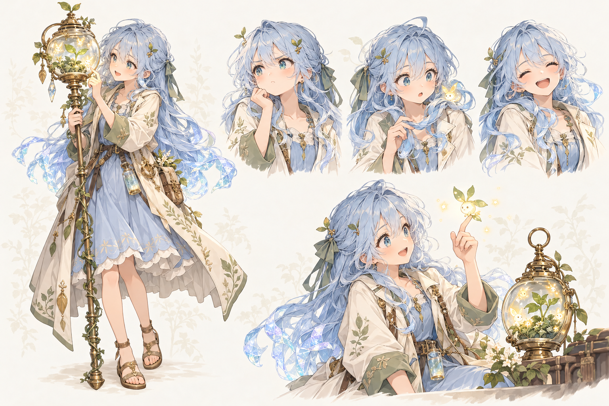
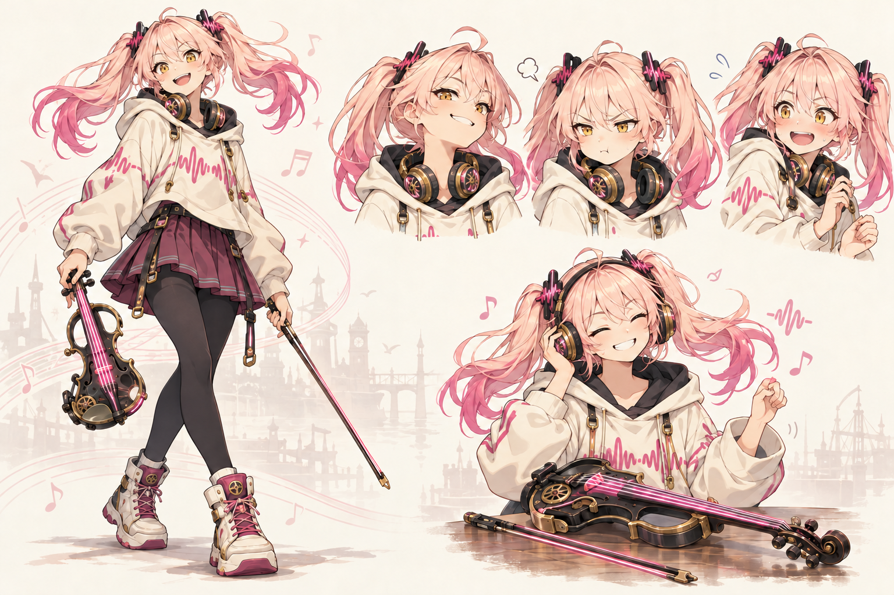
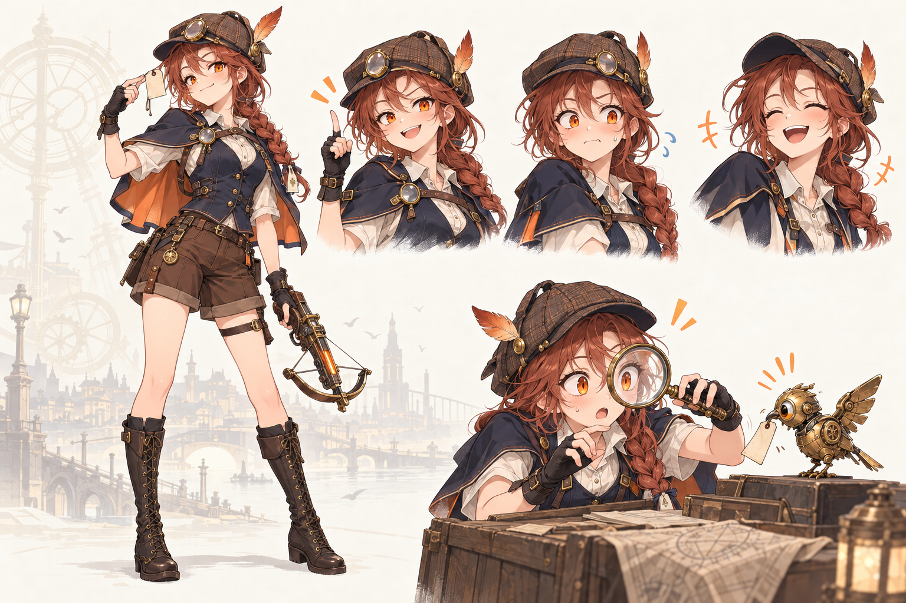

# 유리 · 리엔 · 카야 — 조금 더 앳되고 귀여운 캐릭터 시안

2026-10-18 / Codex 창작 후보 / 사용자 확정 전

요청서의 “조금 더 어린 캐릭터”, “푸리나나 호두 같은 귀여운 요소”를 **앳된 얼굴, 자기만의 작은 허세, 감정이 드러나는 표정, 다시 보고 싶은 행동**으로 풀었다. 현행 캐릭터인 유리(16)·리엔(17)·카야(17)를 골랐고 기존 나이와 고유 소품을 유지했다. 새 인물 추가나 정사 변경은 하지 않았다.

## 이번에 볼 파일

| 시안 | 귀여움의 중심 | 채택 이미지 |
|---|---|---|
| 유리 | 조용하다가 호기심을 못 참는 온실 소녀 | [유리 v1](yuri-cute-board-v1.png) |
| 리엔 | 무대에서는 자신만만, 연습을 들키면 허둥대는 연주자 | [리엔 v2](rien-cute-board-v2.png) |
| 카야 | 명탐정의 허세가 들켜도 금방 웃는 장난꾸러기 | [카야 v1](kaya-cute-board-v1.png) |

모두 **1536×1024 PNG**다. 한 장마다 전신 1컷·표정 3컷·일상 연기 1컷, 총 15개 묘사를 담았다. 유리의 유리빛 머리끝·테라리움, 리엔의 분홍 트윈테일·전기 바이올린, 카야의 측면 땋은 머리·돋보기·석궁이 서로 다른 실루엣을 만든다.

### 유리 — “작게 핀 건 나도 보여.”

우유빛 파랑·세이지·황동색. 작은 새싹 머리핀과 유리로 빛나는 머리끝을 식별점으로 잡았다. 가운과 원피스의 식물 문양이 테라리움으로 이어진다. 귀여움은 늘 수줍게 웃는 모습보다, 뭔가 발견했을 때 눈과 손이 먼저 움직이는 데 있다.

**짧은 연기 초안, 약 4초:** 새싹을 살피던 눈길 → 상대가 다가오자 잠깐 시선만 들기 → 손가락 끝에 내려앉은 빛 생물을 발견하고 표정이 먼저 환해짐 → 함께 보라는 듯 손을 조금 내밀기.

**대사 초안:** “쉿, 지금 피려고 해. …너도 보고 있었구나. 그럼 같이 보자.” 말끝은 작은 웃음으로 풀린다. 누군가를 기다리는 수동적인 인상보다 자기 발견에 초대하는 성격을 살린다.

### 리엔 — “앵콜은 아직 안 받는다니까!”

바닐라색 후디·로즈빛 머리끝·자두색 스커트·황동 공명 장식. 파형을 머리끈과 옷, 활의 빛에 반복했다. 검은 레깅스와 하이탑은 현행 시트 기준을 따른다. 자신감 있는 턱선의 각도와 볼을 부풀리는 반응을 대비시켰다.

**짧은 연기 초안, 약 4초:** 자기 리듬에 맞춰 손가락으로 박자 → 듣는 사람이 있다는 걸 알아차림 → 헤드폰 한쪽을 들고 놀라기 → 금세 턱을 들며 공연이었던 척 마무리. 목에 걸었던 헤드폰을 쓸 때는 한 기기의 두 이어컵만 존재해야 한다.

**대사 초안:** “방금 건 연습이야! …좋았다고? 흠, 그럼 특별히 한 번 더.” 첫 문장은 빠르게, 칭찬을 들은 뒤에는 짧은 정적을 두고 뿌듯함을 숨기지 못한다.

### 카야 — “예상한 일이야. 아마도.”

밤색 땋은 머리·주황 눈·남색 짧은 망토·작은 깃털 탐정모. 명탐정다운 자세를 잡을 때와 허세가 들킬 때 눈썹과 입매가 크게 달라진다. 돋보기는 조사 소품이면서 표정 개그를 만드는 장치다. 석궁은 전신에서 아래로 향하게 했다.

**짧은 연기 초안, 약 4초:** 단서 태그를 들어 올리며 자신만만한 미소 → 태엽 새가 태그를 집어감 → 입을 잠깐 다물고 커지는 눈 → 모자를 고쳐 쓰며 다시 뻔뻔한 미소. 어깨를 과장되게 움츠리기보다 회복이 빠른 성격이 재미의 중심이다.

**대사 초안:** “단서는 절대 도망가지 않아. …잠깐, 그건 내 단서인데? 야, 거기 서!” 마지막은 짜증보다 웃음 섞인 추격으로 읽는다.

## 검수와 상태

- **PASS — 후보 이미지:** 3명 모두 얼굴·핵심 식별자·표정 차이와 전신 잘림을 직접 확인했다. PNG 디코딩, 크기, 원본 복사 해시는 `validation.json`에 기록한다.
- **수정 완료:** 리엔 v1 아래 연기 컷의 헤드폰 중복을 v2에서 고쳤다. v1은 미채택 이력으로 남겼다.
- **수용한 변주:** 카야 아래 컷은 새 대신 본인 눈을 돋보기로 확대했다. 놀람과 장난기가 잘 읽혀 유지했다. 배경·장식은 최초의 단순 배경 지시보다 풍부하다.
- **후보 단계의 한계:** 정확한 전후면·측면 모델 시트, 분리 레이어, 리그, Animation Clip, 음성, 게임 안 실제 재생 자료는 아니다. 설명한 시간·대사·연기는 새 창작 초안이며 구현되어 있지 않다.

## 제작 기록

- [작업 기준](BRIEF.md)
- [세 장의 정확한 원본 생성 프롬프트](PROMPTS.json)
- [리엔 수정 프롬프트](RIEN_EDIT_PROMPT.txt)
- [생성 경로·참조·선택본·SHA-256](provenance.json)
- [최종 시각 판정](.omx/state/cute-characters/ralph-progress.json) — 텍스트 브리프를 기준으로 한 창작자 주관 검수. 외부 이미지 비교 점수는 아니다.
- [파일 검증](validation.json)

내장 `image_gen`으로 새 생성 3회·소품 수정 1회를 수행했다. 사용자가 지정한 현재 폴더에 후보와 제작 기록을 보존했다. 실제 입력 이미지 참조는 리엔 v1→v2 수정에만 사용했다.
