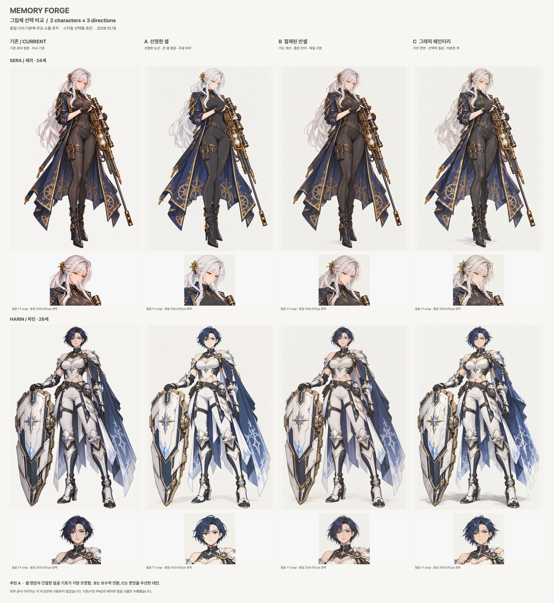

# Memory Forge — 그림체 선택 시안

**추천은 A(선명한 셀)입니다.** 세라 24세·하린 26세의 기본복과 주요 소품을 유지한 세 방향, 총 6장의 선택용 초안입니다. 전체 캐릭터 교체나 게임 적용은 하지 않았습니다.

## 먼저 볼 파일

- [COMPARISON.png](COMPARISON.png): 기존 / A / B / C 순서, 세라·하린 각 전신과 동일 크기 얼굴 크롭.
- [RESEARCH.md](RESEARCH.md): **시안 제작 전에 작성한 Step 0 조사**. 한·일·중 공식 자료의 관찰·공식 설명·Codex 해석과 확인 한계를 구분.
- [individuals](individuals/): 최종 선택 비교에 사용한 1024×1536 PNG 6장. 밝은 중성 배경이 포함된 원본이며 투명 게임용 자산이 아님.
- [PROMPTS.json](PROMPTS.json), [2차](PROMPTS-round2.json), [3차](PROMPTS-round3.json): 실제 전송한 프롬프트와 참조 역할·도구 인자.
- [PRODUCTION.json](PRODUCTION.json), [VALIDATION.json](VALIDATION.json): 제작 경로·결과 파일·검증과 한계. 미채택 두 회차는 `iterations/`에 별도 보존.

## 조사에서 얻은 기준

공식 화면을 직접 확인한 블루 아카이브·니케·FGO·명일방주를 중심으로, 프리코네 공식 소개/설정과 Cygames 공식 인터뷰를 보조 검토했습니다. 프리코네 설정은 애니메이션 자료이며 검색 인덱스 범위를 넘겨 게임 원화 전체의 특징으로 단정하지 않았습니다. 스타레일은 공식 영상 소개만 확인해 렌더링 관찰의 증거에서는 제외했습니다. 자세한 링크와 확인 범위는 [조사 출처 표](RESEARCH.md#조사-방법과-출처)에 있습니다.

- 서브컬처 표현에 하나의 국가별 얼굴 공식은 없습니다. 같은 한국 개발 게임 안에서도 블루 아카이브와 니케의 명암·재질 밀도가 크게 다릅니다.
- 공통적으로 가져올 원리는 **눈·눈썹에 얼굴 정보를 집중하고 코·입의 입체 묘사를 절제하는 것**, 큰 머리 묶음·색면과 선택적 디테일을 구분하는 것입니다.
- 셀 채색만 가능한 것은 아닙니다. 페인터리 원화도 얼굴 기호·실루엣·재질 위계가 명료하면 목적에 맞습니다.
- “AI 같다”는 표현은 제작 방식 탐지나 인종 판정 대신, 균일한 광택·과한 미세 디테일·얼굴의 혼합된 렌더링 규칙을 점검하는 작업 가설로 다뤘습니다.

## 현재 그림과 비교한 관찰

이번에 직접 연 파일은 `INPUTS.json`의 캐릭터 이미지 10개입니다. 초기 세라·하린 시트 2개, 두 인물의 로비 전신·중립 표정 4개, 라비엔·에일라·시온·루미의 대표 전신 각 1개를 확인했습니다. 모든 포즈·SD·표정 파일을 전수 검수한 결과는 아닙니다.

| 관찰 | 해석과 시안의 대응 |
|---|---|
| 기존 눈은 이미 애니메이션식입니다. 특히 세라는 코·입도 상당히 간결합니다 | “눈을 크게”만 지시하면 개선이 제한적입니다. 성인 턱·목·체형을 유지하고 눈선·코/입의 명암 규칙을 일관되게 조정했습니다 |
| 하린의 표정에는 콧대·코끝의 광택, 아래 입술의 체적 묘사가 눈에 띕니다 | A에서는 코를 작은 기호로, 입을 짧은 선으로 정리했습니다. B는 부드러운 성숙함을 더 남깁니다 |
| 은발·남색 머리, 바디수트·갑주·가죽·피부에 작은 하이라이트가 촘촘히 반복됩니다 | 머리의 큰 묶음과 그림자 면을 먼저 읽게 하고, 피부·천은 무광에 가깝게, 금속·유리는 선택적 반사를 남겼습니다 |
| 성인 6명 대표 전신을 어두운 뷰어 바탕에서 볼 때 가장자리 조명과 높은 재질 광택이 반복돼 보입니다 | 비교 시안은 밝은 중성 배경으로 통일했습니다. 배경 변경도 인상에 영향을 주므로 얼굴 확대와 내부 명암을 함께 비교해야 합니다 |
| 초기 하린 시트와 현재 로비 의상의 어깨·허리 노출/갑주 형태에는 이미 차이가 있습니다 | 이번 전신의 구조 기준은 **현재 로비 이미지**로 고정했습니다. 초기 시트는 나이·정체성·방패 구조 확인용이며 이번에 과거 의상으로 되돌리지 않았습니다 |

“서양 사람 같다”는 피드백은 실제 인종을 바꾸라는 의미로 적용하지 않았습니다. 실사/3D에 가까운 코·입 음영과 매끈한 재질이 애니메이션식 눈과 섞여 읽히는 문제라는 창작 해석입니다. 인종·국적·피부색·나이를 바꾸지 않았습니다.

## 세 방향에서 실제로 바뀐 것

| 항목 | A — 선명한 셀 | B — 절제된 반셀 | C — 그래픽 페인터리 |
|---|---|---|---|
| 얼굴 | 뚜렷한 윗눈선, 단순한 코·입, 큰 밝은 피부 면 | 가는 색선과 좁은 음영 전이, 기존 성인 인상에 가장 가까움 | 눈·입은 명료하게, 머리/윤곽 주변의 각진 면을 강조 |
| 선 | 일정하게 정리한 내부 선, 강약 있는 외곽 | 더 섬세하고 부드러운 색선 | 부분적으로 끊기는 색선과 붓면 경계 |
| 피부 | 무광, 큰 셀 명암 | 무광 목표, 제한된 부드러운 체적감 | 큰 밝고 어두운 면, 얼굴 질감은 절제 |
| 머리 | 큰 묶음과 띠 하이라이트 | 넓은 부드러운 반사 띠, 일부 가닥 | 각진 빛 면과 선택적 거친 붓결 |
| 의상 | 재단·색면이 먼저 읽힘, 반사광 절제 | 천/바디수트와 금속/유리의 명암 차이를 보존 | 갑주·망토·코트의 면과 붓맛이 강함 |
| 색·조명 | 기존 팔레트, 중성광, 밝은 바탕 | 같은 팔레트·바탕, 조금 더 부드러운 대비 | 같은 팔레트에서 중간톤을 차분하게, 면의 대비 강조 |
| 이유 | 사용자가 지적한 기존의 렌더링 인상을 가장 명확히 바꾸는 기준 | 기존 외형에서 급격한 이질감을 줄이는 보수적 대안 | 공방의 판타지 분위기와 회화적 개성을 남기는 대안 |
| 남는 약점 | 큰 장비의 세밀한 입체감이 감소 | 기존 그림과 가까워 변화가 약하다고 느낄 수 있음 | 작은 소품·손 접촉·문양이 붓결에 묻힐 수 있음 |

얼굴은 민족 표준 비례를 적용하거나 성인을 유아형으로 바꾸지 않았습니다. 나이·체형을 지킨 상태에서 코·입의 정보량과 눈선, 피부와 머리의 명암을 바꿨습니다. 모든 방향에 같은 캐릭터별 기준 포즈를 사용해 표정·연출 차이를 줄였습니다. 수치로 동일한 얼굴/손 좌표를 보장하는 통제 실험은 아닙니다.

## 보존 기준과 개별 이미지

| 캐릭터 | 유지한 기준 | A | B | C |
|---|---|---|---|---|
| 세라, 24세·170cm | 긴 은백색 낮은 포니테일·호박색 눈·시계 장식, 열린 남색 롱코트·검정 긴 바디수트·허벅지 홀스터·손가락 없는 장갑·검은 부츠, 모래시계 약실 장총, 조준경을 확인하는 차분한 자세 | [A 세라](individuals/a_sera_v03.png) | [B 세라](individuals/b_sera_v03.png) | [C 세라](individuals/c_sera_v03.png) |
| 하린, 26세·180cm | 탄탄한 성인 체형·짧은 남색 머리·회청색 눈·왼 눈썹 위 흉터, 현재 서리빛 갑주의 어깨/허리 재단·한쪽 긴 망토·흰 하이웨이스트 전투 바지·갑주 부츠, 화면 왼쪽의 대형 방패·오른쪽 허리 고양이, 단단한 선 자세 | [A 하린](individuals/a_harin_v03.png) | [B 하린](individuals/b_harin_v03.png) | [C 하린](individuals/c_harin_v03.png) |

설계 근거: `docs/design_v0.8.1.md` §9.3.1·§9.3.5, `docs/AI_WORKFLOW.md` §18, 현재 `art/moments/sera`·`harin`의 기본복/소품. 22세 대안 나이는 적용하지 않았습니다. 정체성·의상 부품의 보존과 장식 선의 픽셀 단위 동일성은 다릅니다. **작은 문양·장식/귀 주변의 선과 반사광은 생성 과정에서 변동하므로 이 시안을 최종 턴어라운드 시트로 사용하지 않습니다.**

## 만든 방법과 실제 한계

1. 공식 자료 조사 후 `RESEARCH.md`를 먼저 작성했습니다. 외부 원본 그림은 저장·복제·생성 입력으로 사용하지 않았습니다.
2. **1차 6장:** 기존 로비 + 기존 시트를 참조한 구독 내장 이미지 편집. 의상은 잘 보존됐지만 기존 광택이 남고 방향 차이가 약해 미채택했습니다.
3. **2차 6장:** 승인된 설정을 텍스트로 고정한 신규 생성. 방향 차이는 선명해졌지만 세라의 새 트임·높은 포니테일, 하린의 방패/소품 배치·갑주 변화 때문에 미채택했습니다.
4. **3차 6장:** 기존 로비는 구조의 유일한 기준, 2차 그림은 스타일만의 참조로 분리했습니다. 기존 의상·소품·포즈를 복구한 이 6장을 비교판에 사용했습니다.
5. **비생성형 배치:** `render_sheet.swift`가 기존 PNG와 최종 시안의 축소본 및 310×310 얼굴 크롭을 배치했습니다. 캐릭터 내용을 다시 그리거나 보정하지 않았습니다. 외부 패키지를 설치하지 않았습니다.

사용 경로는 이 세션의 **내장 `image_gen` 구독 도구**입니다. API 키·SDK·별도 유료 서비스·ImagineArt 크레딧·ComfyUI·Claude는 사용하지 않았습니다. 도구가 이미지 백엔드 모델·seed·steps·sampler를 공개하지 않아 값을 만들어 기록하지 않았습니다. 프롬프트가 같아도 동일 결과 재생산은 보장하지 않습니다. 내장 도구가 자동 관리하는 원본 캐시는 기본 위치에 남고, 직접 만든 결과·기록과 복사한 선택/미채택 파일은 모두 현재 폴더에 있습니다.

**real_constraint:** 생성 도구가 스타일 전환과 세부 의상 고정을 완전히 독립적으로 제어하지 못했습니다. 두 번의 미채택 사유와 교정은 회차별 `VERDICT.json`에 보존했습니다. 최종 결과도 작은 문양·금속/장총 내부 기구·손 접촉까지 완전히 동일한 제작 시트는 아닙니다. 1차의 투명 배경 요청도 시각적으로 후광을 계속 물려받아 최종 비교에는 명시적인 밝은 배경을 사용했습니다. 최종 투명 자산·레이어 PSD·표정/동작 통일·리깅·게임 임포트는 이 요청의 산출물이 아닙니다.

## 추천과 검증 범위

**A를 추천합니다.** 사용자의 피드백을 가장 직접적으로 시험하는 것은 얼굴과 의상의 큰 면을 정리하는 방향입니다. A는 두 캐릭터 모두 기존 인물과 소품이 남으면서 눈선·코/입·머리와 천의 명암 변화가 잘 보입니다. B는 기존 그림을 좋아하면서 광택만 줄이고 싶을 때, C는 붓맛과 어두운 판타지 분위기를 우선할 때의 선택지입니다.

자체 시각 검수는 1차 73/100·2차 76/100로 수정, 3차 91/100로 **선택 비교용 통과**입니다. 점수는 자동 측정이나 사용자 승인 점수가 아닙니다. PNG 디코드·규격·파일 참조·해시는 `VALIDATION.json`으로 검증합니다. 사용자 최종 선택, 전체 캐릭터 재제작, Unity·빌드·게임/기기 수용은 **NOT_RUN**입니다. 코드·원본 자산·게임 데이터·Unity·Git은 수정하지 않았고 커밋·push·Claude 호출도 없습니다.

## 선택 질문 — 하나

**기억 공방 전체 캐릭터의 기본 그림체로 A(선명한 셀, 추천)·B(절제된 반셀)·C(그래픽 페인터리) 중 어느 방향을 고를까요?**
