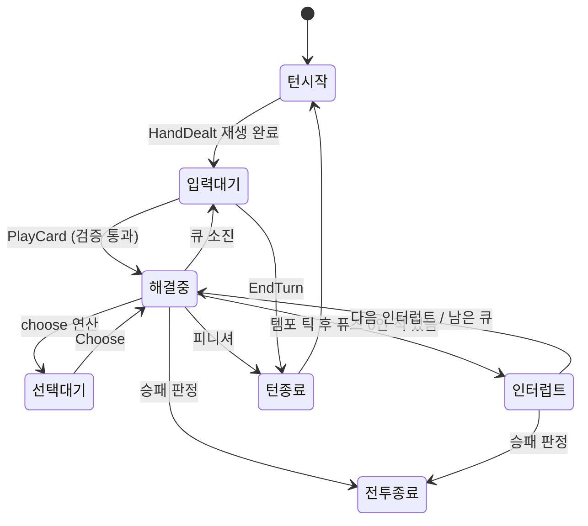

# 03. 새 설계 — 카드 사용 → 효과 해결 → 다음 입력 (동작 명세)

> 레퍼런스 조사([01-research.md](01-research.md))에서는 **무엇을 정해야 하는지**만 가져오고, 답은 새로 정했다. 용어, 수치, 예시 카드, 코드는 모두 독자적이다.
> 구현: [prototype/](prototype/) — Node 24, 의존성 없음. 테스트 27개가 이 문서의 R-·I- 규칙을 검증한다(§13).

## 0. 목표와 비목표

**목표**
1. **결정론.** 같은 상태와 같은 명령은 항상 같은 결과를 낸다. 그래야 되돌리기, 리플레이, 서버 재검증, 자동 테스트가 가능하다.
2. **빠른 연속 입력.** 연출이 끝나기를 매번 기다리지 않는다. 다만 적 행동, 선택지, 턴 전환은 반드시 보여 준다.
3. **예측 가능한 해결 순서.** 카드 문구와 이 문서만으로 결과를 예측할 수 있어야 한다.
4. **엔진 비종속.** 규칙 코어는 Unity, Godot, 웹 어디로든 옮길 수 있다.

**비목표:** 밸런스 수치, 캐릭터 성장·스트레스류 메타 시스템, 네트워크 동기화 구현, 이펙트 자체의 연출.

## 1. 용어

| 용어 | 정의 |
|---|---|
| **Sim** | 전투 규칙과 상태. 명령을 받으면 선택 대기가 아닌 한 **즉시 끝까지** 해결하고 이벤트 목록을 낸다. |
| **Presenter** | 이벤트를 시간축에 재생하는 연출 계층이자 입력 게이트. |
| 명령 | `PlayCard`, `Choose`, `EndTurn`. 앞으로 액티브 스킬 같은 명령이 추가될 수 있다. |
| 원자 연산(Op) | 해결 큐의 최소 단위. 타격 1회, 드로우 묶음 1개, 카드 정산 1회처럼 나뉜다. |
| 반응 | 이벤트에 걸려 발동하는 지속 효과. 파워 카드 등이 등록한다. |
| 해결 구역 | 사용 중인 카드가 머무는 구역. 손패에도, 덱에도, 버린 더미에도 속하지 않는다. |
| **퓨즈** | 적이 다음 행동을 하기까지 남은 '손패 카드 사용' 횟수. |
| 자세 / 경직 | 적의 자세 수치가 0이 되면 경직 상태가 되고, 퓨즈가 늘어난다. |
| 피니셔 | 해결이 끝나면 턴을 종료하는 카드 태그. |
| **배리어** | 타임라인에 남아 있는 동안 새 입력을 막는 이벤트. |
| **백로그 K** | 화면에 동시에 쌓일 수 있는 명령 묶음 수. |
| 확정 사망 표시 | Sim에서는 이미 죽었지만 사망 연출 전인 유닛. 화면에는 보이지만 대상으로 지정할 수 없다. |

## 2. 구조

```
 입력 소스: 터치 / 마우스 / 키보드 / 자동 전투 AI
        │ Command
        ▼
 ┌───────────────── Presenter ─────────────────┐
 │  입력 게이트(IOC, §7) ──거절──▶ UI 피드백      │
 │        │ 통과                                  │
 └────────┼──────────────────────────────────────┘
          ▼
 ┌───────────────── Sim ───────────────────────┐
 │  validate → commit → 해결 큐 drain           │
 │  상태 = 직렬화 가능한 데이터 + 시드 RNG          │
 └────────┬──────────────────────────────────────┘
          │ GameEvent[]   (명령 1개 = 이벤트 묶음 1개)
          ▼
   Presenter 타임라인 → 클립 재생(배속 적용) → 화면
```

**핵심 결정(ADR-1):** 로직이 먼저 끝까지 계산되고, 연출은 그 결과를 재생한다. "지금 입력을 받아도 되는가"는 Sim의 단계와 타임라인 상태를 함께 보고 판단한다.

## 3. 개념 상태



Sim이 외부에 드러내는 단계는 `playerMain`, `awaitingChoice`, `won`, `lost` 네 가지뿐이다. '해결중'과 '인터럽트'는 `dispatch()` 호출 한 번 안에서 동기적으로 지나간다.

## 4. 카드 사용 파이프라인 (P0 ~ P6)

| 단계 | 하는 일 | 상태 변화 | 규칙 |
|---|---|---|---|
| **P0 의도** | 카드를 집고 대상을 고른다. UI만 관여하고 언제든 취소할 수 있다. | 없음 | — |
| **P1 검증** | `validate()`. 실패하면 사유 코드를 돌려준다. | 없음 | R-01 |
| **P2 커밋** | 되돌리기 스냅샷 → `CardPlayed` → AP 지불 → 손패에서 해결 구역으로 이동 | 확정 | R-02, R-03 |
| **P3 효과** | 효과를 원자 연산으로 펼친다. 연산 하나가 끝날 때마다 상태 판정, 그다음 반응 창. | 진행 | R-06 ~ R-09 |
| **P4 정산** | 해결 구역 → 목적지(버린 더미 / 소멸 / 파워), `CardResolved` | 확정 | R-04 |
| **P5 템포** | 모든 적의 퓨즈 -1 → 0이 된 적을 위치 순으로 인터럽트 | 진행 | R-05, R-11 ~ R-13 |
| **P6 복귀** | 피니셔면 턴 종료로. 큐가 비면 `dispatch()`가 반환되고, 이후 입력 여부는 게이트가 판단한다. | — | R-16, I-01 |

P3에서 `choose` 연산을 만나면 남은 큐를 **상태에 보존한 채** 멈추고 `Choose` 명령을 기다린다(R-14).

## 5. 해결 규칙

- **R-01 검증.** 아래 순서로 검사하고, 첫 실패 사유를 돌려준다. 상태는 바뀌지 않는다.
  `BATTLE_OVER` → `AWAITING_CHOICE` → `NOT_IN_HAND` → `UNPLAYABLE` → `NOT_ENOUGH_AP` → `TARGET_REQUIRED` → `INVALID_TARGET`
  대상이 필요 없는 카드에 대상이 같이 오면 무시한다. 효과로 얻은 AP는 다음 명령부터 바로 쓸 수 있다.
- **R-02 커밋.** 효과가 하나라도 처리되기 전에 다음이 이 순서로 확정된다: `CardPlayed` → `ApChanged(cardCost)` → `CardMoved(hand→resolving)`. 되돌리기 스냅샷은 그 직전에 찍는다. 그래서 효과가 '현재 AP'를 읽으면 **지불한 뒤의 값**을 본다.
- **R-03 해결 구역.** 사용 중인 카드는 손패 장수, 드로우, 리셔플, '손패의 카드' 대상 효과에서 모두 빠진다. 손패가 가득 찬 상태에서 드로우하면 그 카드는 버린 더미로 가고 `DrawOverflow`가 난다(손패 상한 기본 10).
- **R-04 정산.** 목적지는 다음과 같다. 파워 카드는 `powers` 구역(반응 등록은 P3에서 이미 끝남), 소멸 태그는 `exhaust`, 나머지는 `discard`. 정산이 끝나면 `CardResolved`.
- **R-05 템포 틱.** **손패에서 사용한 카드만** 틱을 일으킨다. 정산 **뒤에** 살아 있는 모든 적의 퓨즈가 1 줄고(0 아래로는 내려가지 않음), 이때 0인 적을 인터럽트 대상으로 모은다. 효과로 발동된 카드, 액티브 스킬, 적 행동은 틱을 일으키지 않는다.
- **R-06 반응 창.** 원자 연산 하나가 끝날 때마다 걸린 반응들을 큐 **맨 앞**에 넣는다(깊이 우선). 그래서:
  - `CardPlayed`에 걸린 반응은 그 카드의 효과보다 먼저 해결된다.
  - '타격 시' 반응은 다음 타격보다 먼저 해결된다.
  - 턴당 횟수 제한은 엔진이 **발동 시점에** 센다. 카드 스크립트에 맡기지 않는다.
  - 소유자가 죽은 반응은 해결되지 않는다.
- **R-07 동시 반응 순서.** 우선순위 높은 순 → 소유자 위치 → 걸린 순.
- **R-08 타격과 대상.** `damage{hits:N}`은 N개의 타격 연산으로 펼쳐진다. 대상은 **타격마다** 다시 정한다.

  | 대상 규칙 | 각 타격의 대상 |
  |---|---|
  | `enemy` | 지정한 대상. 이미 죽었으면 불발(`HitFizzled`). 단, 카드에 `retarget`이 있으면 살아 있는 상대 중 무작위로 다시 고른다. |
  | `randomEnemy` | 타격마다 무작위 |
  | `allEnemies` | 그 순간 살아 있는 상대 전원 |

  공격한 쪽이 죽었으면 남은 타격은 불발한다.
- **R-09 상태 판정.** 원자 연산 하나가 끝날 때마다 체력 0 이하인 유닛을 사망 처리한다(`UnitDied`, 인터럽트 대기열에서도 뺀다). 이어서 승패를 판정한다.
- **R-10 리셔플.** 뽑을 더미가 빈 채로 드로우할 때만 일어난다. 해결 구역 카드는 절대 섞지 않는다. 이번 턴에 사용한 카드를 섞을지는 설정(`reshuffleIncludesPlayedThisTurn`, 기본 포함)으로 정한다. 섞을 카드가 없으면 드로우는 조용히 실패한다.
- **R-11 경직.** 자세 피해로 자세가 0이 되면 `Staggered`가 나고 퓨즈가 `staggerFuseDelay`만큼 **즉시** 늘어난다. 같은 카드의 템포 틱보다 먼저이므로, "퓨즈 1인 적을 경직시키면 그 카드로는 행동하지 않는다"가 성립한다. 자세는 다음 턴 시작에 회복된다.
- **R-12 인터럽트.** 틱 뒤 같은 명령 안에서 처리하고, 끝나야 `dispatch()`가 반환된다. 적 하나의 행동은 `EnemyActionStarted` → 효과(반응·판정 적용) → `EnemyActionEnded` → 패턴 진행 → `IntentChanged` 순이다. `IntentChanged`는 다음 행동의 퓨즈 값을 담고, 턴 종료 타이밍 행동이면 null이다.
- **R-13 다중 인터럽트.** 위치 순으로 **하나씩 끝까지** 처리한다. 인터럽트 대상은 **틱 시점에만** 모으므로, 인터럽트 도중에 퓨즈가 0이 된 적은 다음 틱까지 기다린다(연쇄 폭주 방지).
- **R-14 선택.** `choose` 연산은 선택 정보와 남은 큐를 상태에 저장하고 단계를 `awaitingChoice`로 바꾼다. 이 동안에는 `Choose`만 받는다. 선택하면 그 옵션의 효과를 큐 맨 앞에 넣고 이어서 해결한다. 선택 대기 중에 되돌리면 카드를 사용하기 전으로 돌아간다.
- **R-15 루프 가드.** 명령 하나의 연산 수가 `maxOpsPerCommand`(기본 500)를 넘으면 `ResolutionAborted`를 내고, 큐를 비우고, 해결 중이던 카드를 버린 더미로 보낸 뒤 입력을 돌려준다. 이것은 콘텐츠 버그 신호이므로 개발 빌드에서는 assert로 멈추는 것을 권장한다.
- **R-16 피니셔.** 정산 → 틱 → 인터럽트가 **모두 끝난 뒤** 턴을 종료한다.
- **R-17 턴 경계.** §8 순서를 따른다. 보존 카드는 손패에 남는다. 방어도는 적의 턴 종료 행동까지 유지되고, 다음 턴 시작에 초기화된다.
- **R-18 결정론과 되돌리기.** 난수 상태는 `BattleState.rng` 안에 있다. `PlayCard`와 `EndTurn` 직전에 스냅샷을 찍는다. 되돌리기는 스냅샷 복원이고, 연출은 `StateRestored`를 받으면 **상태 전체를 다시 그린다**(역재생하지 않는다). 복원한 뒤 같은 명령을 내리면 같은 이벤트가 나온다.
- **R-19 전투 종료.** 판정은 R-09 직후에 한다. 양쪽이 같은 연산에서 동시에 전멸하면 `simultaneousDeath` 설정(기본 승리)을 따른다. 종료되면 큐, 인터럽트, 선택 대기를 모두 버리고, 이후 명령은 `BATTLE_OVER`로 거절한다.

## 6. 적 템포(퓨즈) 설계

**기본형(프로토타입):** 적마다 행동 패턴이 있고, 행동마다 `timing`이 붙는다.
- `fuse`: 퓨즈가 0이 되면 카드 사이에 끼어든다.
- `turnEnd`: 플레이어 턴이 끝날 때 행동한다.

행동을 마치면 다음 행동의 퓨즈로 다시 설정된다. 숫자 퓨즈는 턴을 넘겨도 유지된다(`fuseTickAtTurnEnd = 0`).

**정체 방지 노브:** 기본값에서는 카드를 쓰지 않고 턴만 넘기면 `fuse` 적이 영원히 행동하지 않는다. 다음 중 하나 이상을 고른다.
- `fuseTickAtTurnEnd = 1`: 턴 종료 때도 1씩 줄인다(구현됨).
- 행동 패턴에 `turnEnd` 행동을 섞는다(구현됨).
- 같은 턴에 카드를 하나도 쓰지 않으면 퓨즈가 줄어드는 '압박' 규칙(미구현, 제안).

**독자성을 키우는 변형** — 템포 규칙을 함수 하나(`tickAmount(enemy, playedCard)`)로 분리하면 모두 실험할 수 있다.

| 변형 | 규칙 | 플레이 감각 | 주의 |
|---|---|---|---|
| V1 카드 수(기본) | 손패 사용 1장 = -1 | 직관적이다. 0코스트도 시간을 쓴다. | — |
| V2 AP 지출 | 지불한 AP만큼 감소 | 큰 카드일수록 적이 빨리 온다. 0코스트 연계가 공짜가 된다. | 0코스트 남용 상한이 필요하다. |
| V3 카드 종류 | 예: 공격만 감소 | 방어 카드가 '안전한 시간'이 된다. | 적마다 다르게 하면 정보량이 커진다. |
| V4 적별 감시 조건 | 적마다 반응하는 행동이 다르다(드로우, 공격, 방어 등). | 적 개성이 퍼즐이 된다. | 예고 UI가 필수다. |
| V5 전장 공용 타이머 | 적 개별 퓨즈 대신 공용 게이지 | 단순하다. | 적 간 차별성이 줄어든다. |

## 7. 입력 게이트

**I-01 입력 개방 조건(IOC):** 아래 셋을 모두 만족해야 입력이 열린다.

```
Sim.phase == playerMain   AND   대기·재생 중인 배리어 이벤트가 없음   AND   backlog < K
```

| 규칙 | 내용 |
|---|---|
| **I-02 예약(백로그)** | 앞 명령의 연출이 재생 중이어도 `backlog < K`이면 받는다. Sim은 즉시 끝까지 해결하고, 화면에는 '예약 대기'로 보였다가 차례가 오면 재생된다. K를 넘으면 `BACKLOG_FULL`로 거절한다. |
| **I-03 배리어** | `EnemyActionStarted`, `EnemyActionEnded`, `ChoiceRequested`, `TurnEnding`, `TurnStarted`, `HandDealt`, `BattleEnded`가 타임라인에 남아 있는 동안은 `BARRIER_PENDING`으로 거절한다. 적 행동, 선택지, 턴 전환은 반드시 보고 나서 입력하게 된다. |
| **I-04 확정 사망 표시** | 대상 지정 가능 여부는 **Sim 기준**으로 판단한다. 곧 죽을 적은 화면에 보이지만 지정할 수 없다. 낡은 화면을 보고 들어온 입력은 Sim이 거절하고, 비용은 들지 않는다. |
| **I-05 선택 가시성** | `Choose`는 `ChoiceRequested`가 실제로 화면에 뜬 뒤에만 받는다(`CHOICE_NOT_VISIBLE`). |
| **I-06 배속** | 클립 재생 시간만 나눈다. 해결 결과는 바뀌지 않는다. 이미 큐에 들어간 묶음에는 적용하지 않는다. |
| **I-07 되돌리기** | 남은 연출을 버리고 복원된 상태로 화면을 다시 그린다. 그 뒤 입력이 바로 열린다. |
| **I-08 자동 전투(명세만)** | AI도 하나의 입력 소스다. `validate()`로 후보를 만들고, 점수를 매기고, **같은 게이트**를 통과해 `dispatch()`한다. 사람 입력과 같은 경로를 쓰므로, 자동 전투 전용 버그(카드를 안 쓰고 턴 종료, 입력 지연 등)가 생길 면적이 줄어든다. |

**K 선택 가이드**

| K | 느낌 | 용도 |
|---|---|---|
| 1 | 연출이 끝날 때까지 잠금. 가장 읽기 쉽다. | 튜토리얼, 연출 중심 보스 |
| **2(기본)** | 재생 중에 1장 예약 가능. 대부분의 연속 플레이를 흡수한다. | 일반 전투 |
| 3 이상 | 빠르지만 화면이 결과를 늦게 따라온다. | 고배속이나 숙련자 옵션 |

**타임라인 예시** (`npm run demo` 실제 출력에서 발췌, 1배속, K=2)

```
[  1200ms] ◆ 입력 '연속 찌르기 → 덩치' → 수락 (백로그 1)
[  1200ms] ◆ 입력 '베기 → 졸개' → 수락 (백로그 2 → 화면상 예약 대기)
[  1200ms] ◆ 입력 '방어 태세' → 거절: BACKLOG_FULL
[  1450ms]     타격 1/3: 주인공 → 덩치 피해 3
   …
[  2410ms] ○ 입력 가능 (1210ms 대기, AP 1)
[  2410ms] ◆ 입력 '임기응변' → 수락 (백로그 2 → 화면상 예약 대기)
[  2410ms] ◆ 입력 '선택 0번(화면에 뜨기 전)' → 거절: CHOICE_NOT_VISIBLE
[  3210ms]   선택지 표시: 하나를 고르세요 (2개)
[  3210ms] ◆ 입력 '선택 0번: 방어도 8' → 수락 (백로그 1)
[  3210ms] ◆ 입력 '통찰' → 거절: BARRIER_PENDING        ← 선택으로 퓨즈 0, 적 인터럽트 대기 중
[  3480ms]   ▶ 졸개 행동: 할퀴기 (퓨즈 0 → 인터럽트)
[  4260ms] ○ 입력 가능 (1050ms 대기, AP 0)
   …
[  7110ms] ◆ 입력 '피날레 → 졸개' → 수락 (백로그 1)
[  7110ms]   (확정 사망 표시) 화면상 졸개 생존=true, 지정 가능한 적=[덩치]
```

## 8. 턴 경계

```
EndTurn 또는 피니셔
 └ TurnEnding                 ← 플레이어 쪽 '턴 종료 시' 반응
   └ 손패 정리: 보존 제외 → 버린 더미
     └ turnEnd 타이밍 적 행동 (위치 순, 각자 R-12 순서)
       └ (설정 시) 턴 종료 퓨즈 틱 → 인터럽트
         └ TurnStarted        ← 턴 수 +1, 턴당 횟수 초기화, 방어도 초기화, 자세 회복, AP 충전
           │                    여기 걸린 반응 = '드로우 전' 창
           └ 드로우 N장 → HandDealt   ← '드로우 직후' 창
             └ 입력 게이트 판단 (배리어 재생이 끝나면 개방)
```

## 9. 설정 노브

**Sim (`RulesConfig`)**

| 키 | 기본 | 의미 |
|---|---|---|
| `apPerTurn` | 3 | 턴 시작 AP |
| `drawPerTurn` | 5 | 턴 시작 드로우 |
| `handLimit` | 10 | 손패 상한(넘치면 버린 더미로) |
| `maxOpsPerCommand` | 500 | 루프 가드 |
| `staggerFuseDelay` | 1 | 경직 시 퓨즈 증가량 |
| `fuseTickAtTurnEnd` | 0 | 턴 종료 퓨즈 감소(정체 방지) |
| `reshuffleIncludesPlayedThisTurn` | true | 이번 턴 사용 카드를 리셔플에 포함할지 |
| `simultaneousDeath` | `'won'` | 동시 전멸 판정 |

**Presenter (`PresenterOptions`)**

| 키 | 기본 | 의미 |
|---|---|---|
| `maxBacklog` | 2 | K |
| `speed` | 1 | 배속(이후 묶음부터 적용) |
| `durations` | 표 | 이벤트별 재생 시간. 카드 비행 연출은 `CARD_FLIGHT_MS = 250` |

## 10. 결정 기록 (ADR)

| # | 결정 | 버린 대안 | 이유 |
|---|---|---|---|
| 1 | 로직 먼저 끝까지, 연출은 따라가기 | 연출 시퀀서가 로직을 한 단계씩 구동 | 결정론, 되돌리기, 리플레이, 서버 재검증, 헤드리스 테스트가 모두 쉬워진다. 낡은 화면 문제는 I-04로 막는다. |
| 2 | AP는 커밋 때 지불 | 해결 뒤 지불 | 해결 중 AP를 읽는 효과가 일관되고, 이중 사용을 원천 차단한다. |
| 3 | 템포 틱은 정산 **뒤** | 커밋 때 감소 | 같은 카드의 경직 +1이 먼저 반영돼서 '끊기' 플레이가 직관적이다. 카드 효과는 감소 전 퓨즈를 본다. |
| 4 | 반응은 깊이 우선(큐 앞 삽입) | 너비 우선(큐 뒤 삽입) | '타격마다' 효과가 타격 사이에 보인다. 대신 긴 연쇄가 생길 수 있어 R-15와 턴당 제한으로 묶는다. |
| 5 | 인터럽트 수집은 틱 때만 | 퓨즈가 0이 되는 즉시 | 인터럽트 중 연쇄 폭주를 막고 예측 가능성을 높인다. |
| 6 | 지정 대상이 죽으면 남은 타격 불발(기본) + 카드별 `retarget` | 항상 재지정 | 오버킬을 플레이어가 계획하게 한다. 규칙을 카드 문구에 드러낼 수 있다. |
| 7 | 해결 구역을 따로 둔다 | 사용 즉시 버린 더미로 | 손패 장수, 드로우, 리셔플과의 상호작용이 명확해진다(R-03, R-10). |
| 8 | 선택은 큐를 상태에 보존한 채 정지 | 콜백이나 코루틴으로 대기 | 스냅샷, 중단, 재개, 서버 재검증이 그대로 된다. |
| 9 | K=2와 배리어 | K=1 엄격 잠금 / K=∞ | 응답성과 가독성을 절충한다. 반드시 봐야 할 순간만 강제한다. |
| 10 | 되돌리기 = 스냅샷 복원 + 전체 재렌더 | 연산을 거꾸로 적용 | 파생 상태나 표시가 어긋나는 유형의 버그를 구조적으로 차단한다(레퍼런스 공지에서 반복된 유형, F-34). |
| 11 | 루프 가드와 횟수 제한을 엔진이 중앙 집행 | 카드마다 직접 구현 | 반복·횟수 제한 관련 버그를 한곳에서 막는다(F-23, F-24 참고). |

## 11. 레퍼런스와의 관계

조사에서 **배운 것**은 "이 항목은 반드시 정해야 한다"는 체크리스트다. **답**은 레퍼런스를 따라 하지 않고 새로 정했다.

| 정해야 할 것 | 레퍼런스(01-research) | 이 설계 |
|---|---|---|
| 카운트가 줄어드는 시점 | 미확인(H-03) | 정산 뒤(R-05, ADR-3) |
| 연출 중 입력 | 예약 개념이 있음(F-15), 범위는 미확인 | 백로그 K, 배리어, 확정 사망 표시(I-02~I-04) |
| 스킬류의 카운트 영향 | 에고 스킬은 감소 없음(F-10) | 손패 사용 카드만 틱(R-05) |
| 발동된 카드 | 별도 규칙 있음(F-13) | 틱 없음. 필요하면 효과로 명시 |
| 다단 히트 중 대상 사망 | 미확인(H-10) | 불발 + 카드별 재지정(R-08) |
| 동시 적 행동 | '동시' 사례 있음(F-28) | 위치 순, 하나씩(R-13) |
| 숫자 카운트의 턴 종료 | 미확인(H-08) | 행동 안 함. 노브와 `turnEnd` 행동으로 보완(§6) |
| 되돌리기 | 있음, 복원 관련 버그 반복(F-34) | 스냅샷과 재렌더(R-18, I-07) |
| 서버 | 일부 모드는 전투 중 통신(F-37) | 클라이언트가 즉시 해결. 필요하면 명령 로그와 시드로 서버에서 재시뮬레이션해 검증 |

**독자성 메모(법률 자문 아님):** 일반적으로 규칙 아이디어보다는 이름, 문구, 아트, UI 배치 같은 표현이 보호 대상이다. 그래서 이 설계는 레퍼런스 고유 용어(행동 카운트, 인내, 격파, 에고, 번뜩임 등)를 쓰지 않는다. 예시 카드와 적도 모두 새로 만들었다. §6의 변형으로 템포 규칙 자체에도 차별점을 두는 것을 권장한다.

## 12. 엔진 이식 가이드와 다음 단계

**Unity (C#)**
- Sim은 `UnityEngine`에 의존하지 않는 순수 C# 클래스로 둔다. 상태는 `[Serializable]` 데이터 클래스로 만든다.
- 스냅샷은 수동 `Clone()`이나 직렬화로 만든다. RNG는 mulberry32를 `uint` 연산으로 옮긴다(`System.Random`은 상태 저장이 불편하다).
- Presenter는 MonoBehaviour 하나가 클립 큐를 가진다. 이벤트 하나를 코루틴이나 DOTween 시퀀스 하나에 대응시키고, 드래그를 놓을 때 `IsInputOpen()`을 확인한다.

**Godot:** 구조는 같다. 연출은 `await` + 시그널로 만들면 된다.

**다음 단계**
1. 관찰로 H-03과 H-05를 확정하고, 그 결과를 보고 ADR-3과 ADR-9를 다시 검토한다.
2. 수정자 계층(취약, 약화 등)을 추가한다. 피해 파이프라인을 '기본값 → 공격자 수정 → 방어자 수정 → 방어도' 순으로 둔다.
3. 액티브 스킬 명령 `UseSkill`을 추가한다. 틱을 일으키지 않는다는 점을 규칙으로 명시한다.
4. 자동 전투 AI를 I-08 방식으로 만든다.
5. 콘텐츠를 JSON으로 옮기고 스키마로 검증한다.
6. 연출 시간을 튜닝한다. 다단 히트가 N회를 넘으면 묶어서 재생하고, 배속은 1·1.5·2·3 단계로 둔다.

## 13. 명세 ↔ 테스트 매핑

| 규칙 | 테스트 (`npm test`) |
|---|---|
| R-01 | `R-01 검증 실패 사유는…`, `R-01 AP 부족은…` |
| R-02 | `R-02 커밋…` |
| R-03 | `R-03 해결 중인 카드는 손패에서 빠져 있다…` |
| R-04, R-05 | `R-04/R-05 정산 → 템포 틱 순서…` |
| R-06 | `R-06 반응 창…` |
| R-07 | `R-07 같은 사건에 걸린 반응은…` |
| R-08, R-09 | `R-08 다단 히트…`, `R-08 retarget…` |
| R-10 | `R-10 리셔플…` |
| R-11 | `R-11 경직…` |
| R-12 | `R-12 퓨즈 0 → …` |
| R-13 | `R-13 같은 틱에 여러 적이…` |
| R-14 | `R-14 선택 대기…` |
| R-15 | `R-15 루프 가드…` |
| R-16 | `R-16 피니셔…` |
| R-17 | `R-17 턴 종료…` |
| R-18 | `R-18 되돌리기…` |
| R-19 | `R-19 전투 종료…`, `R-19 같은 원자 연산에서…` |
| I-01 ~ I-07 | `test/presenter.test.ts`의 같은 번호 |
| I-08 | 미구현(명세만) |
