# 탐사 화면 모바일 게임 스타일 2차 (EXPEDITION-RESTYLE-20261018)

사용자 판정: 1차 개편(377b080) 뒤에도 탐사 화면이 "웹사이트 게임 같다, 모바일 게임이 아니다". 서브컬처 모바일 게임 화면에서 정리한 문법(`../expedition_ui_20261018/subculture_ui_reference.md`)을 같은 배치에 입혔다. 규칙·숫자·문구 뜻·Codex 그림은 바꾸지 않았다. 새 틀·아이콘 그림은 그리지 않고 Codex에 필요 목록으로 넘겼다(`art/requests/expedition-restyle-needs-20261018.md`). 그 전까지는 코드로 만든 임시 모양을 쓴다.

작업 전 `codex/late-actions-balance`(377b080, 로비·순간 연출·온보딩 포함)를 이 가지에 병합했다(충돌 없음, 65102e6).

## 바뀐 것

| 화면 | 전 | 후 |
|---|---|---|
| 공통 | 남색 사각 판, 사각 버튼 | 장식 테두리 판(얇은 황동 테두리 + 네 모서리 마름모 + 윗빛), 한 줄 버튼은 알약, 주 버튼은 광택. 휴대폰에서 맞는 칸이 커진 버튼은 누르면 면이 95%로 들어간다(맞는 칸은 그대로, 동작 줄이기에서는 안 움직임). 제목·숫자에 그림자. 머리글 공방 메달 |
| 전투 HUD | "파티 체력" 판 + 문장 두 줄 + 행동력 사각 | 체력 보석 + 굵은 막대, 턴·방어·반격·부채·잔향과 뽑을·버림·소멸·동전, 파티 상태(Core의 `PartyStatusText`를 ` · `로 나눔)를 알약 칩으로. 행동력은 황동 보석 판(글자 `행동력  N` 그대로) |
| 파티 | 사각 판 안 세로 칸 | 판 없이 무대 왼쪽에 SD가 서고, 속성색 이름 알약(속성 아이콘), 게이지, 필살기 알약(같은 맞는 칸) |
| 적 | 사각 정보 상자 | 그림 뒤 등급색 기운 + 발밑 그림자(대상이면 청록 고리). 이름판: 등급색 윗줄, 등급·선택 알약, 체력 막대, 마름모 균열 칸, 속성색 약점 아이콘, 상태 칩(Core의 `StatusText`를 나눔), 의도 배지(황동 마름모 + "이번/다음" 글 그대로) |
| 시간표·연출 줄 | 사각 줄 | 알약 줄 + 시계 표시, 속도 버튼 묶음 |
| 손패 | 평평한 상자 | 주인 속성색 테두리 카드: 그림 창, 비용 보석(숫자), 이름판, 효과 글(측정 방식 그대로), 방식 칩. 고른 카드는 청록 테두리 + 빛 |
| 턴 종료 | 사각 황동 칸 | 황동 원판(눈금 12개, 광택). 맞는 칸은 예전 사각 전체. 행동력 0이면 빛남 |
| 지도 | 사각 칸 | 원형 메달(아이콘 + 상태색 고리, 갈 수 있는 곳은 숨 쉬는 빛) + 이름 리본 + "갈 수 있음/현재 위치", 보스 빨간 고리, 경로 황동 선 |
| 보상 | 사각 카드 | 주인색 테두리 카드, 더 큰 그림 창 + 비용 보석, 동전 배너, 유물 표시 |
| 장소(휴식·공방·상점·사건·기록소) | 아이콘 + 제목 | 큰 메달 + 제목 리본, 줄 버튼 오른쪽 마름모, 상점 품목 판 |
| 저장·결과·시트 | 사각 판 | 장식 테두리 판, 초상 메달 |

이름은 그대로다: ExpeditionFrame, Enemy:<uid>, Party, Ult:<id>, Hand, Hand:<uid>, Node:<id>, EndTurn, Mode:*, ConfirmCard, Pace:*, Timeline, ReservationSlot, RewardCards, RewardCard:*, SkipCard, CardInfo:*, Proceed, CommitMemory, CloseWithoutSave, 온보딩 대상 전부.

카드 비용은 보석 안 숫자만 쓴다(행동력 보석과 같은 황동색). 비용 문구는 방식 버튼("즉시 · 비용 1"), 카드 설명, 보상 카드의 목록 줄에 그대로 있다.

## 전·후 화면

`before/`는 377b080의 화면(1차 개편 후 캡처를 그대로 옮김), `after/`는 이 패스의 화면이다. 1600×900, `battle_five_phone_2340x1080.png`만 휴대폰 비율.

| 화면 | 전 | 후 |
|---|---|---|
| 지도 | 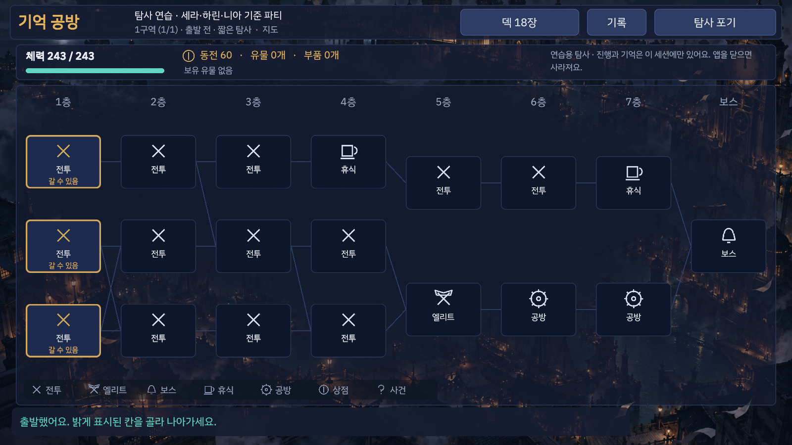 | 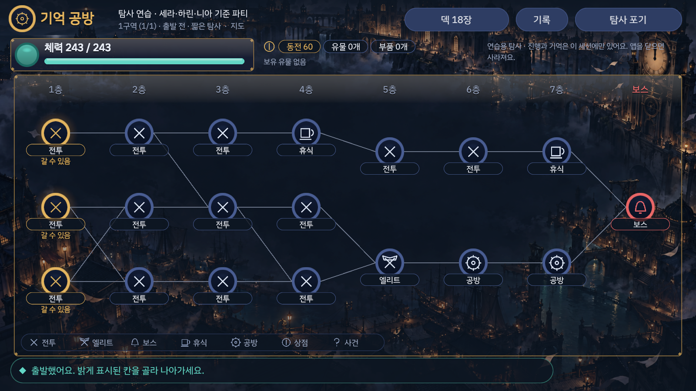 |
| 전투(적 2) |  | 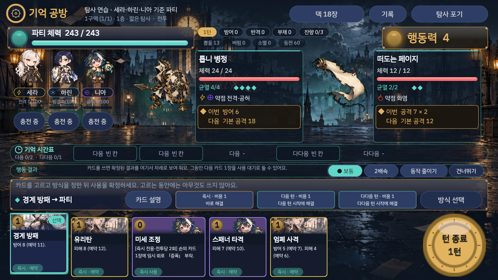 |
| 전투(적 5) | 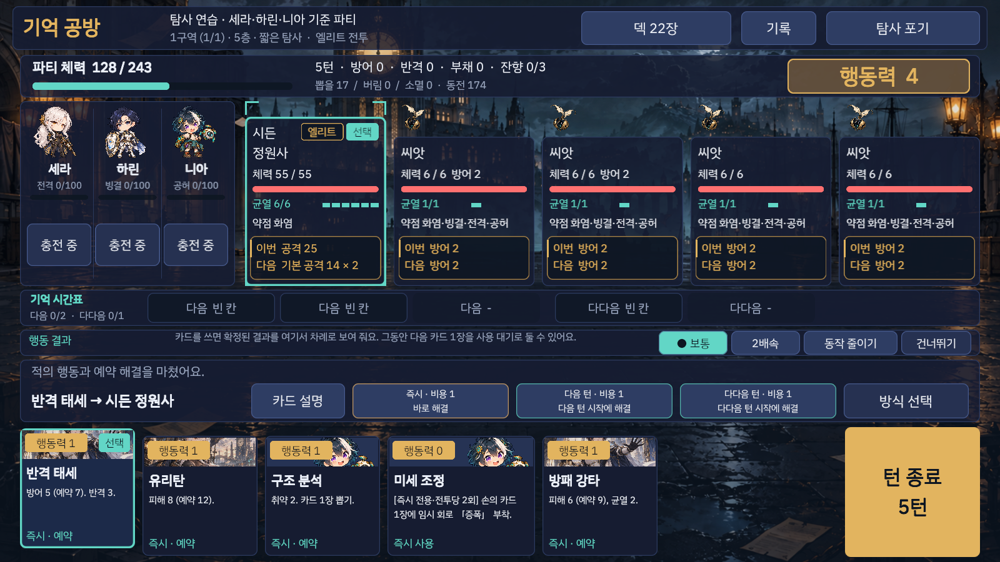 | 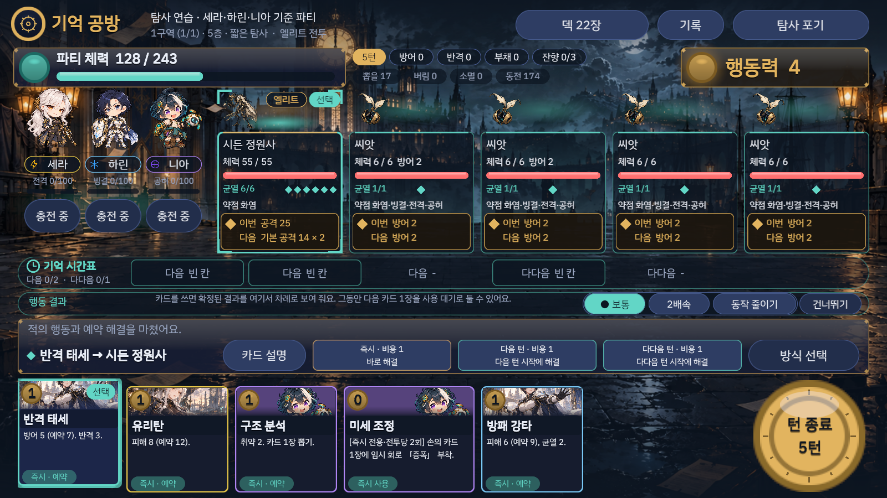 |
| 보스 | 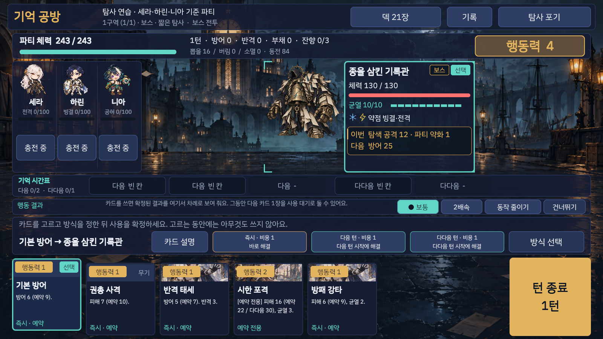 | 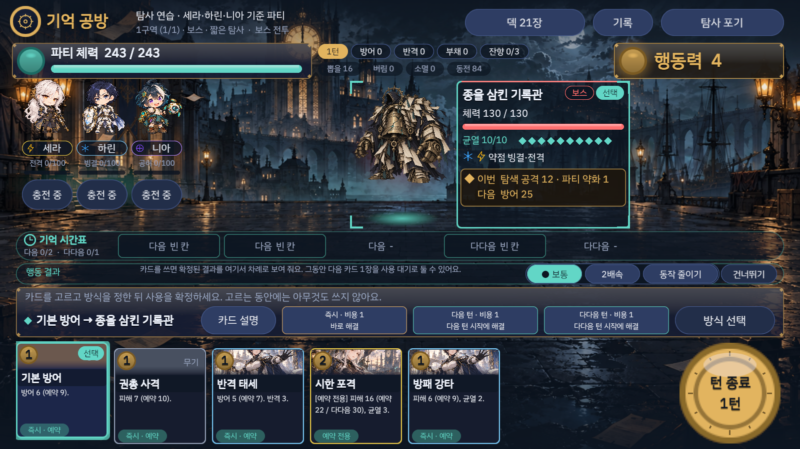 |
| 보상 |  | 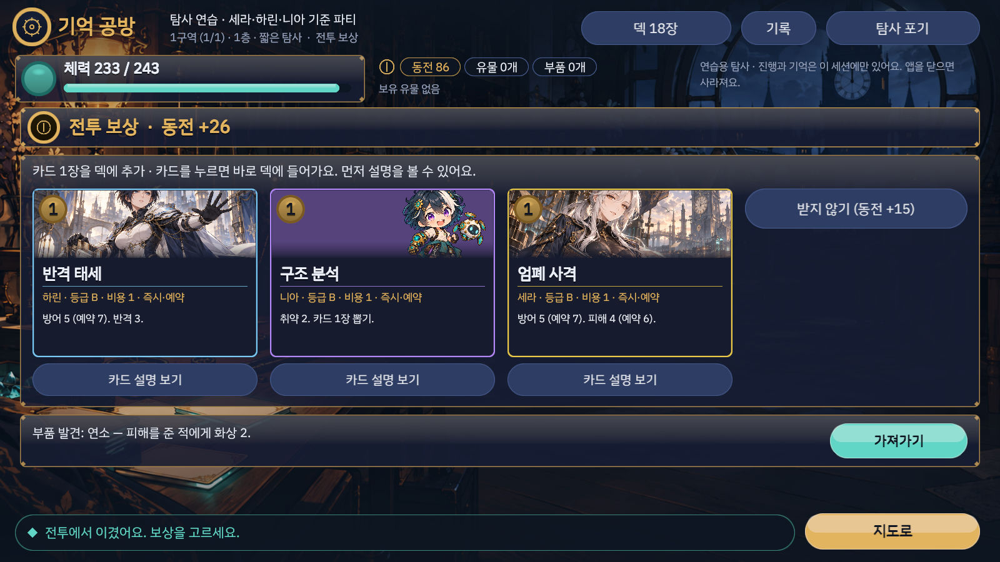 |
| 상점 |  | 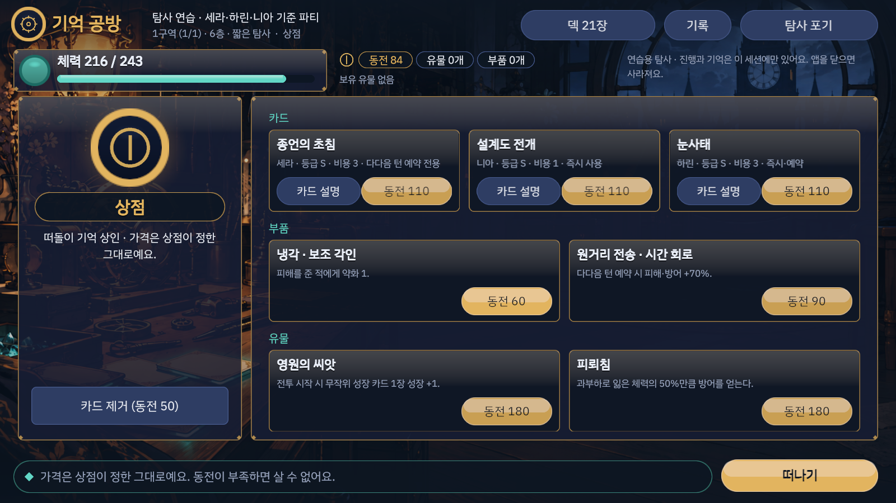 |
| 저장 | 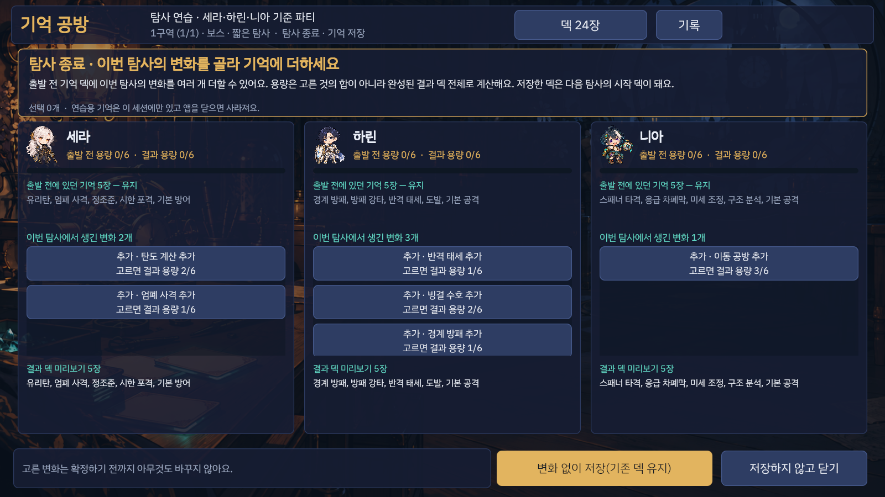 | 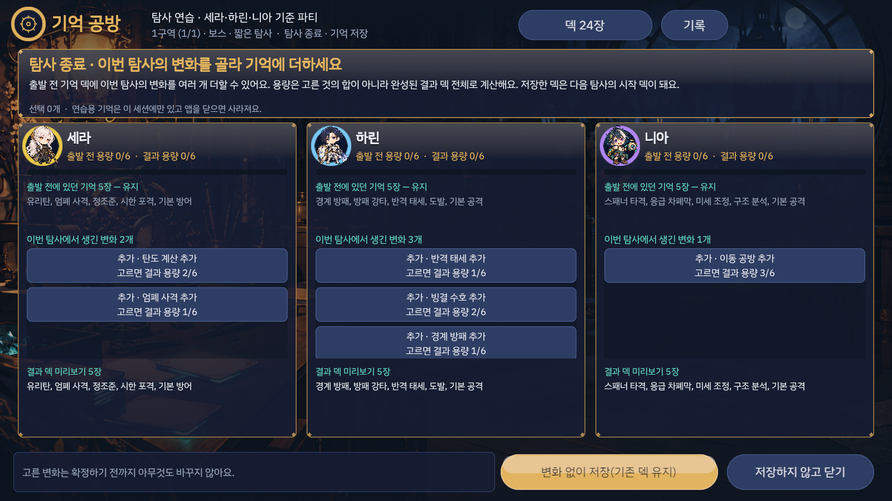 |

나머지(`boss_b_garden`, `boss_b_notary`, `reward_elite`, `rest`, `forge`, `event`, `save_defeat`, `result`, 휴대폰 비율)도 두 폴더에 있다.

## 성능

모양은 세션마다 한 번만 만든다(테두리 두께는 0.5px 단위로 묶어 몇 장만). 한 번 다시 그리는 비용이 늘었다. 배치모드 에디터, `ActionPresentationPlayModeTests`의 전투 다시 그리기 503회 평균: 전 19.3ms → 후 27.3ms(장식 오브젝트를 줄인 뒤). 0.05초 여유를 보는 연출 시간 시험은 통과한다. 실기기(IL2CPP) 측정은 아직 없다.

## 시험

배치모드 Unity 6000.0.46f1, 이 worktree의 프로젝트(공유 메인 Editor 아님).

| 시험 | 결과 | 증거 |
|---|---|---|
| PlayMode 전체 | **342개 중 340 통과, 0 실패, 2 건너뜀**(캡처용 Explicit 2개), 425초 | [`playmode_full.xml`](playmode_full.xml) |
| EditMode 전체 | 3/3 통과 | [`editmode.xml`](editmode.xml) |
| 그림 사본 | `python3 tools/check_art_copies.py`: 81개 모두 원본과 같음 | — |
| 캡처 | `ExpeditionUiCapturePlayModeTests.CaptureExpeditionScreens`(Explicit, `MF_EXPEDITION_SHOTS`): 15화면 모두, 빠진 것 없음 | `after/captured.txt` |

이번 패스에서 시험이 잡은 것:

- **온보딩 이름 충돌.** 시계 표시의 바늘을 `Hand`라고 이름 지었더니, 온보딩 안내와 그 시험이 손패(`Hand`) 대신 바늘을 찾아 1과의 "방식 고르기" 단계가 건너뛰어졌다(`OnboardingPlayModeTests.FirstRunCoach…` 실패). 바늘 이름을 `ClockHand`로 바꿔 해결했다.
- **적 의도가 스크롤 아래로 숨는 경우(Codex 3차).** `ExpeditionUiLayoutPlayModeTests`에 `AssertIntentsInView`를 더했다. 걷기 중 살펴보는 모든 전투 화면(네 밀도)에서 살아 있는 적의 "이번 … / 다음 …" 글이 위쪽의 어떤 `RectMask2D`에도 가려지지 않아야 한다(6마리 넘을 때 칸째로 넘기는 무대 띠 `Enemies`는 제외). 의도를 다시 스크롤에 넣는 변이로 돌리면 이 시험이 실패한다: `battle step 144 of seed 1235: the intent of Enemy:e22 … is partly hidden by InfoScroll` ([`layout_mutation_intent_scrolls.xml`](layout_mutation_intent_scrolls.xml)).

기존 휴대폰 48dp·겹침·잘림 검사(1차 패스)는 그대로 모든 화면에서 통과한다.

## 독립 리뷰 (Codex, 읽기 전용)

`command codex exec -s read-only -m gpt-6.1-sol -c model_reasoning_effort="high"`. 요청서와 회차별 변경 요약: [`ops/ai/tasks/claude-expedition-restyle-review-20261018.md`](../../ops/ai/tasks/claude-expedition-restyle-review-20261018.md). 매 회차 diff 전체(2회차부터 앞 회차와의 차이 포함)와 `after/` 화면 4–8장을 붙였다.

| 회차 | 세션 | 판정 | 지적 → 처리 |
|---|---|---|---|
| 1 | `01a14e0c-96d0-71b0-afa9-d7aa402a53f9` | BLOCKING | ① 파티 상태 칩이 여러 개면 줄이 넘쳐 적 칸(y 162)을 덮음 → 칩을 먼저 재고, 두 줄에 안 들어가면 작은 칩 세 줄(y 87–159)로 ② 5적 전투에서 정보판이 그림을 밀어냄(엘리트 그림 사라짐) → 좁은 칸의 배지를 그림 위 윗줄로, 이름판 글씨 줄임 ③ 성능은 현실 제약 |
| 2 | `01a14e15-bd92-7fc1-a418-c779f5822434` | BLOCKING | 상태 칩 한 줄이 생기면 엘리트 그림이 다시 사라짐 → 좁은 칸은 그림 자리를 늘 확보(최소 76, 배지·상태 칩이 있으면 그만큼 더), 상태는 그림 위 칩으로. 선택 의견: 동작 줄이기를 켜면 눌림이 즉시 돌아와야 함 → 반영 |
| 3 | `01a14e21-24d3-77f2-93e6-45fa57f30354` | BLOCKING | 상태가 붙으면 이름판이 스크롤되어 "다음" 의도가 가려짐, 기존 잘림 검사는 마스크를 못 봄 → 의도 배지를 이름판 아래에 고정하고 나머지만 스크롤, `AssertIntentsInView` 추가와 변이 확인 |
| 4 | `01a14e29-280a-7f32-8c00-02329b45c5ff` | **NO_BLOCKING_DEFECT** | 고정·마스크 검사·변이 XML 확인. 남은 것: 실기기 성능(현실 제약), 5적 전투가 여전히 정보판 중심으로 보임(선택 의견, 모든 적 의도를 늘 보이는 선택의 절충) |

## 남은 범위

- 사용자 판정 필요: 이제 모바일 게임처럼 보이는지.
- Codex UI 키트·필요 목록의 그림이 오면 임시 모양을 바꾼다.
- 5적 전투는 모든 적의 의도를 늘 보이게 두었기 때문에 정보판의 존재감이 여전히 크다(Codex 선택 의견). 상세를 선택 시 펼치는 방식은 의도 가시성과 맞바꾸는 결정이라 이번에 하지 않았다.
- 실기기 DPI·노치·글자 배율, 실기기 다시 그리기 시간은 미검증.
- 감사 기록: [`root_session_audit.json`](root_session_audit.json).
