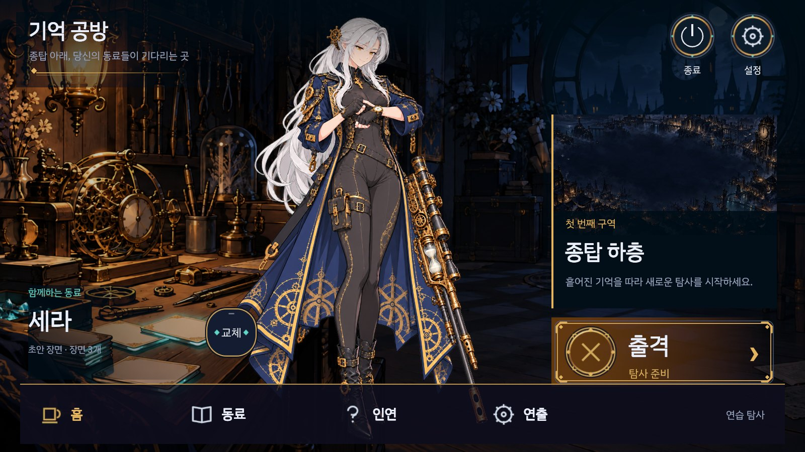
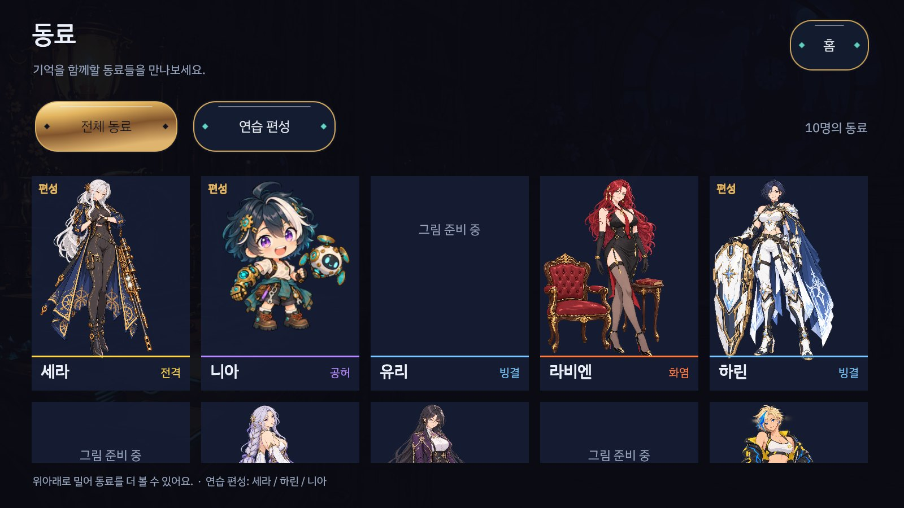
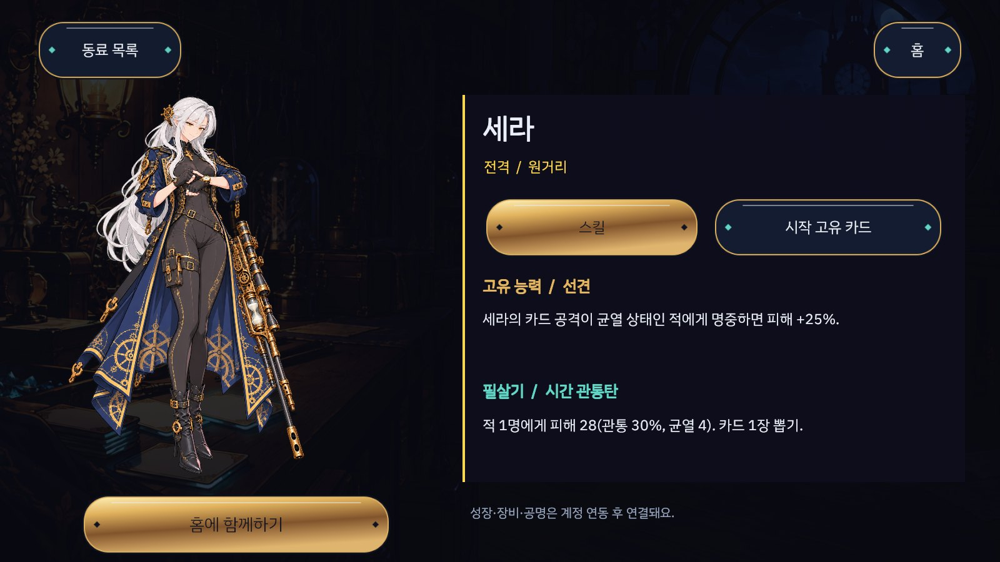
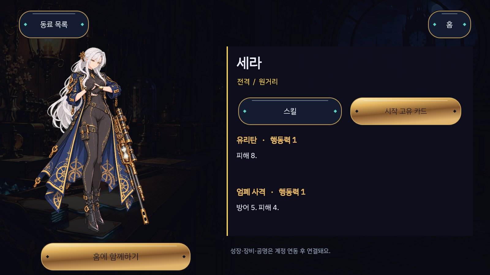

# Home hub and companion catalogue — 2026-10-21

The user asked for a subculture mobile-game home with an atmospheric background, orderly navigation and an actual place to inspect companions, replacing the stacked deckbuilder-like menu. `DESIGN.md` records the design and scope.

## Implemented

- Full workshop backdrop with the companion centred in the composition, a destination banner and primary expedition action on the right, and a stable home/companions/bond/scenes dock.
- A full companion catalogue from the ten real character definitions, with all/active-practice-party filters and a scrolling portrait grid.
- Companion details show the real element, weapon type, passive, ultimate and starting-card descriptions. Cards reuse `BattleText.Card`; no duplicate rules or invented stats.
- Available companion art can be selected as the home representative. The fixed practice expedition party remains Sera/Harin/Nia.
- The entire authored frame fits within the phone safe area. Original moment framing returns while a scene plays; authored art, dialogue and motion files remain unchanged.
- Missing imported illustrations are labelled. Account ownership, growth and equipment transactions are not implemented or fabricated.

## Captures

Actual Unity offscreen renders of the authored 1600×900 frame:

## Verification

- RED: the new catalogue navigation test failed because `OpenCompanions` did not exist.
- GREEN: MomentPlayer class17/17; combined full PlayMode353 passed,0 failed,6 explicit capture tests skipped (359 total). Captures ran explicitly and passed separately.
- EditMode10/10, including the APK packaging regression guard.
- Engine358/358, proposals14/14, Python64/64, docs9/9, handoff33/33. Handoff used the existing project PDF-test environment after the default and bundled interpreters lacked PyMuPDF; no checks were removed.
- CoreChecks all suites exit0; ServerChecks1179 assertions in file mode. New PostgreSQL execution is separate; the starting head83a654a passed its PostgreSQL and Playwright CI steps.
- Independent Claude Opus review: REQUEST_CHANGES → REQUEST_CHANGES → APPROVE. Modal click-through, length selection sprites, localized weapon name and non-vacuous representative/load-failure regressions were fixed. Latest lifecycle/UI/capture selection19/19 passes; sanitized CLI evidence is in `cli-evidence.json`. Final guarded device check follows below.

## Simplification and limits

The home uses four working navigation routes instead of seven equal-weight rows and inactive system links. Existing uGUI helpers, art kit, content loader and moment player are reused; no new dependency or economy rule was added. Three character illustrations are not yet imported. Growth, ownership and editable parties need their actual account flows. Device appearance and player preference remain distinct from automated tests.

## Review corrections

Modal panels now block pointer and keyboard access to the home. Selection art changes in both directions. All button targets honor the 48dp conversion, and the expedition/settings/list layouts were enlarged accordingly. Missing content is tested by throwing from the real Start loader before any successful load; the error screen cannot re-enable the home and exposes a reload action. SD artwork remains catalogue-only; the card tab explicitly says starting unique cards. Party names come from the shared reference party and actual character definitions.

The original delivery manifest was checked before changes and already differs from the active development checkout; it was not regenerated or presented as passing. Historical input-audit provenance remains explicit; fresh CoreChecks still pass.

Final source review: Opus High APPROVE in session9ad28090-625b-40df-89de-09839f15faac. The required fresh Start-loader failure test and capture selection passed19/19 after that review. Whole-suite353/0failed/6explicit skips and final lifecycle check are separate receipts.

## Final device receipt

The final IL2CPP ARM64 development APK was built with the packaging guard, installed using a replacement install (no data clear), and launched on Galaxy S24 Ultra. Its installed `base.apk` SHA256 matches the newly built APK (`device-receipt.json`). Actual touch navigation opened the catalogue, Harin's real skills and starting unique cards, selected Harin as the non-default home companion, and switched long/short expedition selection with only the chosen button lit. The attached phone PNGs retain the real display aspect and safe-area layout. The final full-screen workshop is drawn once, without the earlier safe-frame backdrop seam.

These are agent-operated device smoke checks, not a user's visual acceptance or a complete expedition playthrough. Account-owned roster, editable party, the three missing imported portraits and balance-stage2 remain separate.

The short expedition map and first battle were also entered on the phone. Selecting Sera's attack showed the target HP24→16 with the correct highlighted segment; a real1300ms held touch displayed the long-press peek. The run retained0 InvalidCastException and0 Unity error lines. Ultimate cut-in and simultaneous two-finger input remain automated-suite evidence, not a claim of physical-phone acceptance.

## User follow-up: utility controls

The user rejected the plain exit/settings controls. They now use filled dark circular faces, the existing brass portrait rim, a gear/power icon and a small Korean label. The existing cached circle/ring shape is reused; no new asset, dependency or action was introduced. The review approved behavior and flagged the power-gap direction, which was aligned in the final capture. Targeted lifecycle/navigation/capture19/19 and final icon capture1/1 passed. The full353-test result above precedes this presentation-only adjustment; it is not represented as a second full run.

The circular-control APK was rebuilt and installed; installed bytes again match its SHA256. Fresh launch and icon→settings→close were checked on the phone with0 Unity error lines. The prior complete navigation/HP-preview/held-peek receipt is preserved under `previous_accepted_apk` rather than attributed to this later APK.
