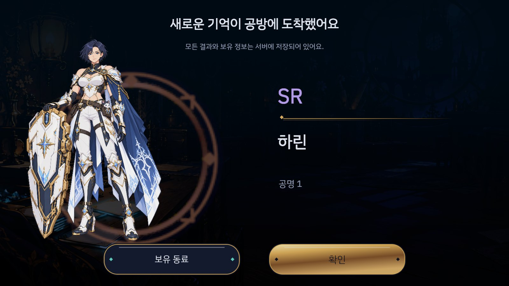
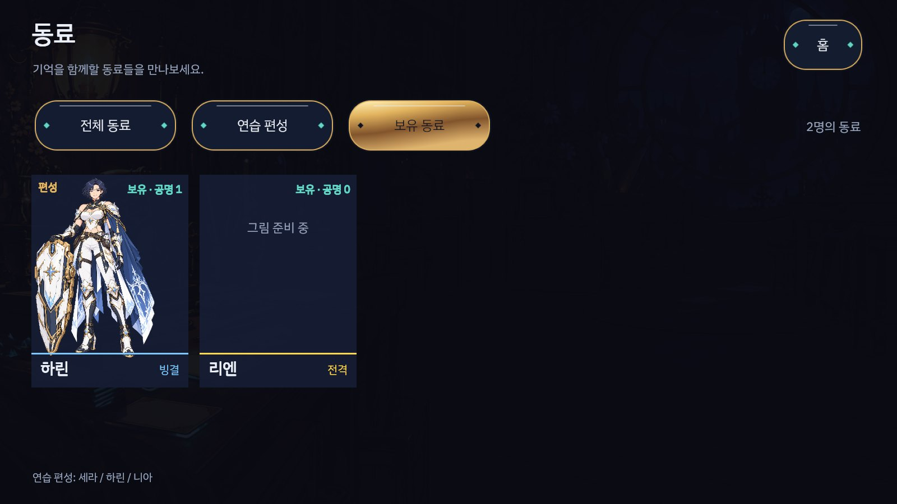
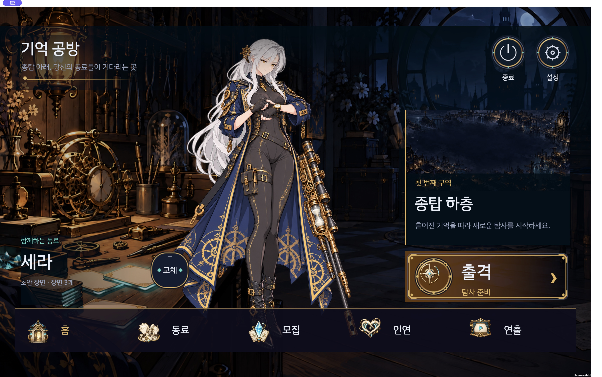

# 실제 개발 계정 모집·PC 화면 수용 — 2026-10-21

사용자가 실제 모집 연결과 PC 검은 화면 수정, 저장·영수증 결함 해결, 시험·CI 마무리를 요청했다. 휴대폰은 사용자가 제외했다. Codex가 UI/전송/아이콘/PC를, 공식 Claude Opus CLI가 Core/서버를 구현하고 반대편 AI가 독립 검토했다. 가격·확률·보상 수치·창작 캐릭터 원본·운영 배포는 바꾸지 않았다.

## 실제 동작

- 공방 홈의8개 아이콘 원본을 만들고 Unity에 같은 바이트로 수입했다. 종료·설정은 불투명한 원형 황동 프레임, 하단은 정렬된 동료/모집/인연/연출 내비게이션이다. 큰 터치 대상에서도 버튼이 프레임 밖으로 나가지 않는다.
- Development 계정을 연결하면 서버 잔액·보유 동료·천장·최근 결과를 읽는다. 상시/초보 모집의1회·10회, 비용 확인, 전체 개별/종합 확률, 런칭 선물1회, 보유 필터, 조건을 충족한 SSR 선택을 연결했다. 미접속/미보유/재화 부족 상태를 꾸미지 않는다.
- 서버가 기존 Core에 CSPRNG를 주입하고 재화·천장·보유·중복 보상·원장·정확한 영수증을 같은 트랜잭션으로 확정한다. 그 뒤 도착 연출과 결과를 보여 주며 건너뛰기·동작 줄이기를 지원한다. 미확정 명령은 기존 영속 outbox의 같은 ID/본문으로 재확인한다.
- 비밀번호 입력은 메모리에만 두고 새 로비에서 다시 요구한다. 로그인 자격·계정 보유를 연습용 고정 편성으로 대신하지 않는다.

## 저장·영수증 수정

두 결함을 재현하고 해결했다. 첫째, 저장된 recruitment receiptBody를 각 원장 prefix의 재구성 응답과 바이트 단위로 대조해 결과/비공개 필드 변조를 거부한다. 둘째, recruitment 상태가 지워져도 남은 영수증을 역참조하므로 새 계정처럼 취급하거나 런칭 선물을 다시 받지 못한다. 독립 실제 HTTP53판정에서 두 경우 모두 `STORE_CORRUPT`와 원본 바이트 보존을 확인했다.

명령은 영수증 확인 → expectedRevision → Core 규칙 → 원자적 저장 순서다. 실패한 오래된 명령이 나중에 재화가 생겼다고 실행되지 않는다. private CSPRNG tape로 전체 원장을 다시 실행해 현재 상태를 대조하며, 공개 응답에는 tape/seed/credential/내부 영수증을 넣지 않는다. OS 소유자가 일관되게 전체 파일을 다시 쓰는 경우를 인증하는 MAC은 아니다.

## 실제 localhost UI 모집

별도 Development 계정의 승인된 런칭 보상(무료 결정1600+상시 티켓10)만 사용했다. 실제 HTTP 사전 검증은21회, 재시도·서버 재시작 후 같은 결과/잔액을 확인했다. 최종 검토된 서버로 재시작한 뒤 Unity PlayMode의 실제 연결 폼과 `Button.onClick`으로1회 모집을 추가 실행했다.

- 확정 전: revision4, 무료 결정160, 티켓0, 누적21회.
- 확정 후: revision5, 무료/유료 결정0, 티켓0, 누적22회, 하린2·리엔1. 하린 공명1 결과가 저장됐다.
- 첫 시험은 서버 확정·연출 건너뛰기까지 성공한 뒤, 단일 결과가 tile이 아닌 Arrival 화면인 것을 잘못 검사해 실패했다. assertion을 고쳤고 추가 지불·재지급·초기화 없이 읽기 전용 후속 시험을 실행했다.
- 후속 시험은 새 로비2개에서 재인증하고 전체 snapshot 동일성, 최근 하린 결과, 실제 보유 목록과 잔액 부족 확정 차단을 확인했다. 최신 기록을 오래된 캐시가 가리지 않는 회귀와 함께2/2 통과했다. [실제 재접속 기록](recruitment-live-reconnect.json).

이는 실제 HTTP를 쓰는 Unity UI 자동 검사다. 네이티브 마우스로 모집을 끝냈다는 증거와 구분한다. 계정 정보 파일·자격·DB 연결 문자열·원장 원본은 커밋하지 않았다.

## PC 검은 화면

macOS Development 빌드가 Codex 뒤에서도 시작 프레임·비동기 응답을 처리하도록 `runInBackground`를 고정하고, 자격 정보 없는 개발 전용 시작/입력 진단을 더했다. 새 앱은 네이티브 창과 전체 화면 모두 공방 홈을 표시했다. 시작 로그는 Lobby1/Canvas1/frame3/background=true이며 누락된 MonoScript나 managed 코드 제거는 없었다.

네이티브 자동 클릭은 mouse-down이 도착해도 Unity `Input.mousePosition`이 창 밖의 고정 위치를 읽었다. 이 자동화 경로로 수동 입력 수용을 주장하지 않는다. 메뉴 접근성 동작과 화면 표시는 확인했고, 실제 모집은 위 Unity UI/HTTP 경로로 확인했다. 사용자의 물리 마우스 판정과 휴대폰 판정은 남는다.

## 검증·독립 검토

[검사 기록](verification.json), [실제 Core/서버 해시](server-integrity-final-sha.json), [fixture 변경 범위](run-create-fixture-refresh.json), [시각 판정](visual-verdict.json)을 따른다.

- ServerChecks 파일1916/1916, 실제 독립 PostgreSQL16 모드1776/1776. 사용자/운영 DB는 사용하지 않았다.
- CoreChecks 전체 통과, 새 CSPRNG/기존 seed 동등성89/89. BCL client148/148, engine358/358, proposals14/14, Python64/64, docs9/9, handoff33/33.
- 최종 Unity PlayMode **392 통과·실패0·제외10**(명시적 캡처8, 환경변수 없는 실제 계정 opt-in2). Editor10/10, 최종 macOS Development 앱568,327,855바이트/14.5초/오류0·nullable 경고2를 확인했다. 자세한 수치는 `verification.json`에 기록한다. 원격 CI는 [PR #2](https://github.com/choijunhuk/memory-forge-rpg/pull/2)의 정확한 새 head SHA를 확인하며 이전6f2d11c 성공으로 대체하지 않는다. 로컬 원격 CI 영수증은 `ops/ai/local/followup-20261021/remote-ci-recruitment.json`이다.
- Claude client 독립 리뷰 REQUEST_CHANGES → 보완 → APPROVE. 유한 초보 모집 종합 SSR 확률2.1385%, late receipt/refresh 오류·새 화면 관통·키보드 초점·최신 기록 캐시를 검증했다. [최종 client 리뷰](RECRUIT-CLIENT-FINAL-REVIEW-20261021.md), [PC 리뷰](PC-DESKTOP-REVIEW-20261021.md), [실제 UI 시험 보완 리뷰](RECRUIT-PC-LIVE-REREVIEW-20261021.md).
- source/data/gameplay fixture case는 유지했다. run-create fixture는 바뀐 입력 감사 목록40개와 Node 런타임 진단만 갱신했고 cases/counts/source pins는 동일하다. 배포 매니페스트는 재생성하지 않았다.

## 변경·단순화·남은 범위

변경은 `MemoryForgeLobbyClient`/`MemoryForgeLobbyRecruitment`, recruitment DTO/session/outbox, `Gacha`/공통 loader, 서버 recruitment/store/strict contracts, DesktopBuild/Diagnostics와 대응 시험·아이콘·fixture에 한정했다. 기존 Core 상태 기계·계정 transaction·outbox·uGUI를 재사용했고 새 의존성/별도 저장 서비스는 추가하지 않았다.

실제 연결 범위는 인증된 loopback Development 계정이다. 상용 계정 인증·결제·운영 배포, 보유 캐릭터 편성/성장 거래, 제한/무기 모집 회전 일정과 기존 Core MVID 저장 이관은 별도다. Core 빌드가 다른 기존 파일은 계속 거부하며 초기화하지 않는다. 실제 HTTP로 유료 잔액 양성·SSR 선택 성공·초보50회 완료는 재화를 임의 지급하지 않아 미실행이며 Core/프로토콜 시험과 구분한다. 캐릭터별 신규 전용 연출·누락 그림3명·2단계 밸런스 조정과 최종 사용자 미감 판정도 이 단위에서 완료로 표시하지 않는다. 일반 모집 도착 연출·1/10회 결과는 구현했다.
