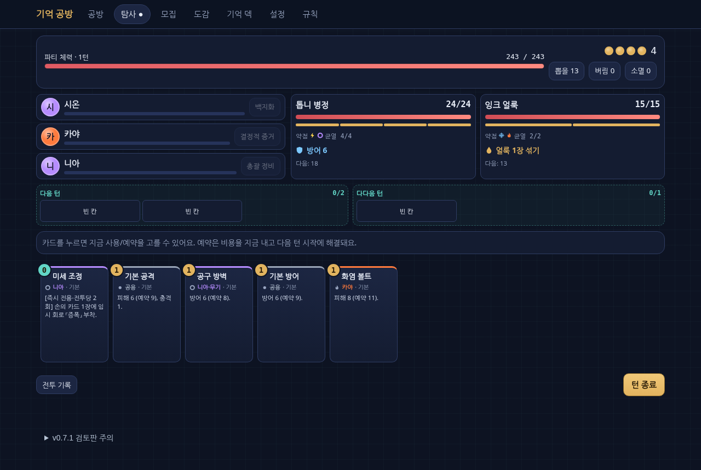
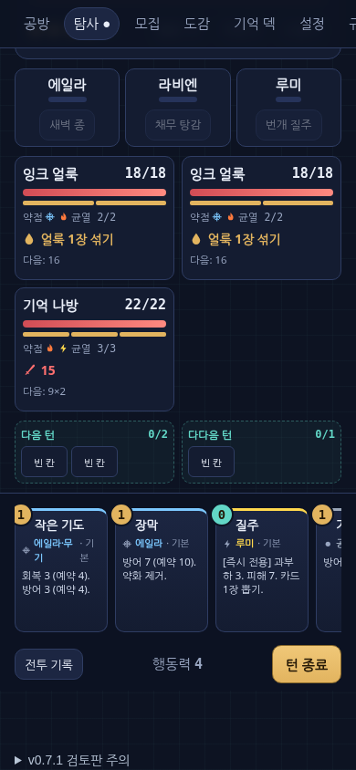

# 기억 공방 v0.7.1 교차검토·수정 명세


---

## 00 / 읽기 안내 · 기억 공방 v0.7.1 교차검토 · 수정 명세

**v0.7 원본과 외부 리뷰를 모두 검증한 개발 인계판**

기준: 2026년 10월 14일 · Android 우선 / PC 고려 · Claude + Codex 협업

이번 산출물은 v0.7의 99쪽 설계서를 없애고 새 게임으로 바꾸는 문서가 아니다. 원본의 구조와 명칭을 유지하면서, 재현한 결함의 수정과 아직 결정되지 않은 정책 변경을 분리한다. ZIP에는 기존 전체 프로젝트, 수정한 JS 참조 엔진·HTML, 새 회귀 시험, 독립 경제 계산, 이 검토서가 함께 들어 있다.

### 먼저 읽을 결론
**채택:** 첫 턴 방어 유지, 진화 카드의 성장 계열 판정, 공생 이끼의 실제 성장 이벤트 처리.

**그대로 채택하지 않음:** 외부 패배 저장 패치, “후반 구역 전부 구현·검증 완료” 주장, 조건을 생략한 68.9% 설명.

**구체화한 제안:** 이전 덱을 보존하는 저장 v2, 1~3층 단일 파티, 가챠와 분리된 본편 결말, 캐릭터별 매력 중심 아트 지침.

> **중요:** 기본 HTML의 패배 저장 정책은 아직 v0.7 방식이다. 새 저장 v2는 독립 모듈·시험만 있으며 기존 탐사/화면/서버에 연결되지 않았다. 유료 재화·확률·가격·캐릭터 나이는 임의 변경하지 않았다.

문서 상태: 기술 수정은 이 패키지에 구현. 사업·서사·아트의 변경안은 별도 표기. Unity·서버 애플리케이션·실기기·실결제는 이번에 구현하거나 검증하지 않았다.


---

## 01 / 두 가지를 먼저 구분 · 핵심 결과만 먼저

| 구분 | 이번 결론 | 실제 상태 |
|---|---|---|
| 첫 턴 보상 | 방어 0 → 26, 반격 0 → 2 | JS·HTML 수정 / 회귀 시험 |
| 유리 진화 | 3장인데 계열 수 0 → 3, 성장 합 0 → 9 | JS·HTML 수정 |
| 공생 이끼 | 필살기 방어 12 → 24, 씨앗 시작 방어 0 → 3 | JS·HTML 수정 |
| 패배 저장 | 기존 내용을 잃는 정책은 바꿀 가치가 큼 | 안전한 대체 모듈만 제안 |
| 외부 저장 패치 | 용량 6에 비용 9 저장·기존 카드 복제 재현 | 병합하지 않음 |
| 가챠 68.9% | 96회를 한 목표에 쓸 수 있다는 조건의 확률 | 수학은 맞음 / 설명 보강 |
| 캐릭터 매력 | 일상복·동작·표정·관계를 획일화할 이유 없음 | 10명별 제작 브리프 추가 |
| 나이 구성 | 20대 후반 위주의 인상은 낮출 수 있음 | 성인 20~24세안, 승인 전 |

**수정본 검사:** JS 51개, Python 23개, 저장 v2 제안 14개 시험 통과. 짧은 탐사 100회·정규 40회 퍼즈에서 예상 밖 예외 0. 브라우저 2개 뷰포트에서 4판을 UI로 진행해 완주 2·패배 2 경로를 확인했다. 자세한 범위와 제약은 마지막 검증 장을 본다.

**기존 검사와 다른 점:** 원본 27개 JS 시험이 모두 통과했는데도 버그가 있었다. 시험의 숫자는 품질 점수가 아니며, 실제로 검증하는 규칙과 실패 사례가 중요하다.

**다음 우선순위:** 저장 정책 선택·어댑터 → 후반 적 행동의 완전 명세 → 동일 조건 밸런스 측정 → C# 전투 이식. 아트는 별도 브리프로 병렬 진행하되, 데이터에 없는 제작 완료를 주장하지 않는다.


---

## 02 / 근거와 범위 · 무엇을 원본 사실로 보았는가

| 표기 | 자료 | 취급 |
|---|---|---|
| O | Memory_Forge_v0.7_Design.pdf, 99쪽 | 설계 문장·현재 정책 |
| Z | Memory_Forge_v0.7_Handoff.zip | 실제 코드·데이터·원본 시험 |
| R | memory_forge_v0_7_review_and_patch_proposal.md | 외부 주장·패치 후보 |
| T | reports/review_v071/ 아래 이번 실행 기록 | 이 환경의 관찰 결과 |
| P | proposals/ 및 이 문서의 ‘제안’ | 미승인·미통합 변경안 |

원본 ZIP은 해시 매니페스트를 확인한 뒤 별도 폴더에 복사해 시험했다. 수정은 작업 사본에만 적용했다. 외부 리뷰에 쓰인 “실측”, “완성본”, “즉시 적용 가능”은 증거가 함께 있는지 확인하고 재현 여부를 따로 기록했다.

### 이전 판과의 충돌 처리
v0.7은 반천장, 무기 모집, 성능 공명, 기억 저장을 도입하고 ADR에 디렉터 요청으로 적었다. 이번 첨부만으로 그 승인 경위를 모두 확인할 수는 없다. 따라서 v0.6의 정책으로 임의 회귀하지 않고 **첨부된 v0.7을 검토 기준선**으로 삼았다. 신규 확률·수급·저장 호환 변경은 제안으로 남긴다.

### 아트 수정의 증거 한계
제공된 원본에는 수정 후 유리 대사와 리엔 포즈가 있지만, 해당 두 항목의 **수정 전 원문과 실제 diff는 없다**. 특정 대사·포즈가 정말 문제였는지, 왜 고쳤는지 단정할 수 없다. 이 검토는 확인되는 최종 지침의 과도한 범위와 새로운 제작 대안을 다룬다.

### 자동화 결과의 한계
JS 시험은 C# 전투 전체 이식이나 운영 서버의 정확성을 보증하지 않는다. 브라우저 자동 클릭은 조작 경로의 작동을 확인할 뿐 사람의 재미·캐릭터 매력·손가락 터치 가독성을 검증하지 않는다. [O §0.4, §19; R §1; T]


---

## 03 / 채택 판단 · 외부 제안별 판정표

| 항목 | 판정 | 이유 / 적용 |
|---|---|---|
| Fix 1 첫 턴 방어 | 수정 수용 | 첫 턴만 초기화 예외. 다음 턴 초기화 시험 추가 |
| Fix 2 성장 계열 | 수정 수용 | 유효한 진화 관계 검사, 복제·메아리 계보까지 보완 |
| Fix 3 이전 덱 보존 | 방향 수용 / 코드 반려 | 원본 정책 변경임. 제안 코드에 용량 초과·복제 발생 |
| Fix 4 공생 이끼 | 수정 수용 | 씨앗 경로도 실제 수정. 성장 없는 경우 보상 금지 |
| Fix 5 임시 플래그 | 수용 | `_added`를 실제 추가 카드에 설정. 이것만으로 저장은 해결 안 됨 |
| 후반 적 23종 | 후보 수용 | 원본 초안 전사 성격. 엔진·밸런스 완료는 미입증 |
| 신규 행동 6종 | 수정 수용 | 침묵 비용·해제, 2페이즈 패턴 전환 코드 등이 필요 |
| 시즌 110~115회 | 비교안 수용 | 확률 상승 효과는 검산. 적용·가격 변경은 보류 |
| 누적 픽뚫 보정 | 문구 반려 / 재설계 | ‘마지막 픽업 이후 2패’는 현재 보장 규칙에서 도달 불가 |
| 기억 용량의 무료 해금 | 방향 수용 | 인연 10 대신 승급 4의 대안 제시 |
| 기록 균열 1~3층 1팀 | 수용 제안 | 초기 육성 부담 완화. 진행기는 아직 미구현 |
| 12/20 결말 분리 | 수정 수용 | 12개 경로 미정·핵심 정보 가챠 잠금이 여전히 남음 |
| 중반 위기·공방장 연출 | 수정 수용 | 원본 ‘쏘지 말 것’과의 정합성 유지, AP 보너스 중복 금지 |

**아직 아무 항목도 실서비스에 배포한 것이 아니다.** 이 표의 ‘수용’은 검토 판단이며, 상태 열이 구현인지 제안인지 결정한다. 신규 사업·서사 정책을 사용자가 이미 승인한 것처럼 ADR에 기록하지 않는다.


---

## 04 / 첫 턴 경계 · 시작 방어는 첫 턴에 남아야 한다

원본 `begin()`은 청동 톱니, 무기 패시브, 하린 공명의 시작 효과를 먼저 처리한다. 바로 뒤의 `startTurn(true)`가 방어와 반격을 지워, 지급 직후 효과가 사라졌다. 원본 설명 자체도 시작 지급과 무조건 초기화를 연달아 나열해 모순의 원인이 되었다. [O §5.3, p.11; R §2.1; T repro_original.json]

| 재현 장착 | 부여 값 |
|---|---:|
| 청동 톱니 | 방어 8 |
| 장부 자물쇠 R5 | 방어 8 |
| 하린 공명 4 | 방어 10 |
| 하린의 관련 반격 효과 | 반격 2 |
| 원본 begin() 직후 | **방어 0 / 반격 0** |
| 수정본 begin() 직후 | **방어 26 / 반격 2** |

### 채택한 규칙
**최초 턴은 이전 플레이어 턴이 없으므로 시작 보상을 정리하지 않는다.** 2턴부터는 기존 방어 정리와 보루 유지 수치를 그대로 적용한다. 단순히 방어 초기화 전체를 삭제하면 무한 누적이라는 다른 게임이 된다.

### 추가한 검증
첫 턴 지급 보존, 두 번째 턴 정상 초기화, 보루 수치만 유지하는 경로를 각각 검사했다. 전투 시작용 성장 유물로 받은 방어도 같은 경계를 통과한다.

### 이식 요구
C#에 같은 `first` 의미를 옮기고, 시작 이벤트와 일반 턴 시작 이벤트를 구분한 트레이스를 만든다. 첫 턴만 통과하는 숫자 시험이 아니라 2턴까지 비교해야 한다. 현재 C#에는 전투 전체 구현이 없으므로 이번 수정이 C# 전투에 반영됐다고 말하지 않는다.


---

## 05 / 진화는 계열을 잃지 않는다 · 유리: 성장 가능성과 성장 계열의 분리

원본에서 진화 카드 자체에는 `growth:true`가 없고, 원본 카드 ID는 `from`에 남는다. 일부 해결 후 콜백은 이미 `from`을 확인했지만, 성장치 합·성장 카드 수·손패 조건은 기본 카드의 `growth`만 보았다. 따라서 “모든 패시브가 아예 호출되지 않는다”는 외부 설명은 과장이고, **효과별 판정 불일치**가 정확한 진단이다. [O §5.11, §6.3, §9.3 유리; R §2.2]

| 개념 | 기본 성장 카드 | 유효하게 진화한 카드 |
|---|---|---|
| 성장 계열인가 | 예 | 예 |
| 유효 성장치 | 실제 0~3 | 3 |
| 다시 성장할 수 있나 | 3 미만이면 가능 | 아니오 |
| 온실·성장 해결 패시브 | 적용 | 적용 |
| 읽었다는 이유로 이끼 발동 | 아니오 | 아니오 |

수정본은 `growthRoot / isGrowthInst / effGrowth`를 분리했다. `from` 문자열만 믿지 않고 **원본의 진화 목록에 현재 ID가 있는지** 확인한다. 임의 카드에 유리 카드의 `from`을 붙여 계열 보너스를 얻지 못하게 한다.

### 재현 결과
진화 3장의 성장 카드 수는 0→3, 성장치 합은 0→9가 되었다. 유리 고치: 수호를 즉시 사용하면 기본 방어 9에 공생 결속 6이 더해져 15가 된다.

### 복제까지 확인
탈피와 메아리 사본에 `from`을 전달해 진화 계보가 끊기지 않게 했다. 비용 0 플래그는 그대로 유지한다. 저장 시 토큰 제외 규칙도 바꾸지 않았다. 토큰을 포함한 계열 카운터의 세부 밸런스는 원본 설계에 맞춘 현재 구현이며, 실제 전투 재미 검증과는 별개다.


---

## 06 / 이벤트 일관성 · 공생 이끼: 성장할 때만 한 번

공생 이끼의 문장은 “성장이 일어날 때마다 방어 3”이다. 원본에서는 예약 성장·일부 선택 성장만 이끼를 호출하고 `growLowest`, `growAll`, `eternal_seed`는 직접 성장치만 올렸다. [O §7.8, p.27; R §2.2; T]

### 수정 구조
`applyGrowth(카드, 양, 출처/상한 옵션)`에서 성장 가능 여부, 0~3 범위, 횟수 제한, 실제 증가, 이벤트, 이끼 방어를 한 번에 처리한다. 효과별 상한은 통일하지 않는다. 원래 상한과 별개인 필살기·씨앗은 그 의미를 유지한다.

| 상황 | 성장 처리 | 이끼 |
|---|---|---|
| 예약 카드, 일반 상한 미만 | 실제 +1 / 개체당 1회 | 방어 3 |
| 같은 개체 예약 재해결 | 추가 성장 없음 | 없음 |
| 이미 성장 3 | 변화 없음 | 없음 |
| 진화 카드 로드 | 유효 성장 3으로 해석 | 없음 |
| growLowest로 두 장 +1 | 실제 두 이벤트 | 방어 6 |
| 이후 growAll로 두 장 +1 | 실제 두 이벤트 | 방어 6 |
| 영원의 씨앗 +1 | 시작 이벤트 1회 | 방어 3 |

필살기의 원래 방어 12 + 성장 네 번의 방어 12 = **24**를 재현했다. 외부 문서는 씨앗도 고친다고 적었으나 제공한 코드 블록에는 씨앗 수정이 빠져 있었다. 이번 패키지는 해당 경로와 1턴 방어 보존을 함께 시험했다.

### 추가 안전장치
성장치가 음수·비정수·3 초과인 상태는 불변식 검사에서 거절한다. 성장량 +2가 한 번 적용될 때 ‘성장 이벤트 1회’인지 +1 두 번인지 구별한다. 현재 공생 이끼는 성공한 카드 성장 처리 1회당 한 번이며, 이 해석은 새 효과를 만들 때도 문서화해야 한다.


---

## 07 / 가장 위험한 패치 · 패배 저장은 버그 판정부터 달랐다

**이전 덱의 강화가 사라지는 현상은 재현된다. 그러나 원본 §8.5는 ‘이전 기억 덱이 아니라 기본 덱에서 재구성’한다고 명시한다.** 따라서 구현이 명세를 어긴 버그라기보다는, 영구 자산을 잃게 하는 정책과 UX 문제다. [O §8.5, p.28; R Fix 3]

외부 패치는 이전 기억 덱을 시작점으로 바꾸면서, 선택 목록은 여전히 기본 덱 대비 변경으로 계산한다. 이 둘을 섞으면 같은 변경이 두 번 적용된다.

| 독립 재현 | 외부 패치 결과 | 문제 |
|---|---|---|
| 이전 덱에 희귀 카드 2장, 비용 6 / 용량 6 | 새 희귀 카드 비용 3을 고르면 최종 비용 **9** 저장 | 선택분 3만 검사, 이전 6 누락 |
| 이전에 저장한 추가 카드가 변경 목록에 다시 나타남 | 같은 카드를 다시 선택하면 **2장** | 이전 덱에 ‘추가’를 재적용 |
| 다른 캐릭터만 선택 | 그 캐릭터 밖의 이전 덱은 보존 | 이 정상 사례만 시험하면 앞의 실패를 놓침 |

### 이번 병합 판단
외부 Fix 3은 **병합하지 않았다**. `_added` 변수 정리는 별도 적용했지만 이를 “저장 보존 해결”이라고 부르지 않는다. 기본 HTML은 여전히 v0.7의 패배 저장 정책이며, 다음 저장 정책을 결정하기 전에는 가치 있는 테스트 덱을 잃을 수 있다. 프로토타입에는 그 주의 문구를 표시한다.

### 제품 제안
패배의 대가는 **이번 탐사의 신규 성과 제한**에 두고, 출발 전에 확보한 덱을 자동으로 지우지 않는 방향을 추천한다. 단, 저장 상한을 지키며 변경 1개를 선택할 수 없을 때는 “기존 덱 유지”가 반드시 가능해야 한다. 이 변경에는 저장 스키마·UI·마이그레이션 설계가 필요하다.


---

## 08 / 저장 v2 제안 · 안전한 이전 덱 보존의 계약

**제안 모듈:** `proposals/memory_v2.cjs` · 기존 Run/HTML/서버와 미연결. 테스트 14개를 따로 제공한다.

### 스냅샷과 선택
출발 스냅샷 `before`, 종료 스냅샷 `after`를 서버가 보유한다. 카드에는 종류 ID와 별개로 **저장된 개체 키**가 있다. 같은 유리탄 두 장을 구분해야 어느 카드의 강화·부품을 남기는지 알 수 있다. 클라이언트는 완성 덱이나 비용을 보내지 않고 서버가 제시한 변경 ID 하나만 선택한다.

| 변경 | 처리 | 과금/용량 |
|---|---|---|
| 기존 카드 강화 | 해당 개체의 강화만 반영 | 완성 결과의 총비용 다시 계산 |
| 기존 카드 진화 | 원본→허용 진화로 변경 | 진화 비용 2 |
| 부품 교체 | 지정 슬롯만 변경 | 기존 부품 비용을 새 비용으로 교체 |
| 카드 추가 | 해당 신규 개체를 한 번 추가 | 희귀도 + 강화 + 진화 + 부품 전부 |
| 제거 | 해당 키의 개체만 제거 | 최종 기본 덱 대비 제거 비용 |
| 선택 없음 | before 그대로 | 기존 덱 유지 |

### 반드시 지킬 순서
스냅샷 유효성 → before/after의 실제 차이 산출 → 선택 0~1개 확인 → before 사본에 변경 → **전체 결과**의 소유·개체·진화·부품·용량 검사 → 커밋. 실패하면 원본과 원장을 건드리지 않는다.

### 이번 제안 모듈의 범위
순수 JSON 입력에서 위 로직과 비용 검사를 시험했다. 실제 저장 카드 키를 발급·이관하는 코드, HTTP 인증·행 잠금, 기존 버전의 데이터 마이그레이션, 저장 화면 연결은 없다. 독립 모듈의 통과를 완제품 저장 기능으로 해석하면 안 된다.


---

## 09 / 저장 v2 수용 조건 · 마이그레이션과 화면까지 끝나야 완료

| 단계 | 구현할 것 | 완료 조건 |
|---|---|---|
| M1 개체 식별 | 저장 개체 key 발급, 새 탐사에 계승 | 중복 종류·진화·복제 후에도 유일성 유지 |
| M2 변화 계산 | 출발/종료 차이, 삭제·추가·진화·강화·부품 | 기존 추가 카드가 다시 ‘신규’가 되지 않음 |
| M3 용량 검사 | 기본 덱 대비 최종 결과 비용 | 이전 비용 + 신규 비용이 상한 초과하면 거절 |
| M4 서버 적용 | 계정·덱 버전 잠금, 멱등 영수증, 이력 | 재전송·다른 기기 동시 저장에도 한 번 적용 |
| M5 화면 | 남는 것/이번에 잃는 것, 결과 덱 미리보기 | 선택 없음으로 기존 덱 유지, 비용 초과 이유 표시 |
| M6 마이그레이션 | 이전 ID-only 덱에 결정적 개체키 부여 | dry-run, 백업, 이력 대조, 재실행 동일 결과 |
| M7 C# 이식 | JS와 같은 직렬화·규칙 | 정상/실패/중복 명령 트레이스 일치 |

### 새 회귀 시험이 막는 사례
기존 용량 6에서 비용 3 추가, 같은 종류의 두 개체 중 하나만 강화, 진화와 강화가 함께 생겼을 때 진화만 선택, 임시 부품을 영구 저장하려는 입력, 카드 종류를 임의로 다른 카드로 바꾸는 입력, 이미 저장된 추가 카드를 다시 선택하는 경로를 검사했다.

### 정책 선택의 남은 문제
정상 완주 저장도 before 기반 누적형으로 바꿀지, 완주에서는 전체 새 덱 편집을 허용할지 결정해야 한다. 여기서 제안한 모듈은 **패배 복구의 한 변경 처리만** 담당한다. 용량이 찬 덱에서 제거+추가를 하나의 교체로 묶을지는 별도 정책이며 이번에는 허용하지 않았다.

### 출시 전 차단
이식·마이그레이션이 준비되지 않으면 새 저장 정책을 운영 데이터에 적용하지 않는다. 숫자 1개를 바꾸는 패치가 아니라 영구 자산의 의미를 바꾸는 변경이다.


---

## 10 / 후반 적 검토 · 23종 데이터 ≠ 후반부 구현 완료

외부 문서의 적 23종은 대부분 원본 §10.4에 이미 있던 이름·HP·균열·패턴 초안을 코드 형태로 옮긴 것이다. 이 전사는 유용하지만 **미구현 행동과 미작성 대본을 해결한 증거는 아니다.** [O §10.4; R §4·§6]

| 행동 | 제공 코드에서 보이는 것 | 추가로 필요한 것 |
|---|---|---|
| apDrain | 다음 AP 보너스를 감소 | 최소 0, 부채와 별도 합산, 반복 착취 표시 |
| sealSlot | 봉인 시각 / 대체 방어 | 이미 봉인·빈 칸 없음·만료 경계 시험 |
| delayRes | 만기 +1, 실패 시 버림 | 원래 위력 분류 유지 여부, 카드 보존·불발 안내 |
| silence | 상태 플래그 설정 | 예약 비용 +1, free 우선순위, 다음 턴 뒤 해제 |
| eatName | 버린 더미에서 소멸 | 토큰 우선·소멸 훅·재현 RNG·빈 더미 처리 |
| phase | 설명문만 있음 | 실제 전환 코드, 패턴·약점·균열·의도 교체 |

**발견한 추가 위험:** 원본 `enemyMove`의 알 수 없는 행동은 조용히 무시될 수 있었다. 이번에는 `UNSUPPORTED_EFFECT`로 실패하도록 수정했다. 따라서 새 적 이름만 데이터에 붙이고 UI가 진행되는 것을 ‘동작함’으로 착각하지 않는다.

### 다음 개발 원칙
23종은 후보 데이터로만 보관한다. 행동 스펙과 테스트를 먼저 끝내고 데이터에 합친다. 적 데이터 추가만으로 `authored:true`를 켜면 본편이 완성된 듯 표시되므로, 전투 데이터 준비·서사 준비·클라이언트 연출 준비를 별도 플래그로 관리하는 안을 추천한다.


---

## 11 / 적 행동 상세 · 침묵·시간 지연·2페이즈의 빠진 규칙

### 침묵
다음 플레이어 턴의 예약 비용에 +1을 적용한다는 것이 원본 명세다. `s.pst.silence`를 저장하는 것만으로는 부족하다. `costOf`, 버튼 미리보기, 사전 검사, 턴 종료 만료가 함께 바뀌어야 한다. 여러 침묵을 맞으면 지속만 연장할지 비용을 중첩할지도 정해야 한다.

**권고안:** 비용 증가는 +1 비중첩, 남은 유효 턴 수는 상한 2. ‘무료 사본 평생 0’과 ‘다음 카드 무료’ 효과는 비용 최종 0을 우선한다. 기존 무료 규칙을 적이 깨는 것이 의도라면 별도 명시가 필요하다. 이 안은 아직 구현하지 않았다.

### 시간 지연
외부 코드는 지연된 예약의 `kind`까지 after로 바꾼다. 그러면 일부 카드가 지연됐는데 오히려 더 강한 다다음 수치를 얻을 수 있다. **발동 시각과 약속한 위력 분류를 분리하는 안**을 추천한다. 적에 의한 지연은 due만 바꾸고, 플레이어의 앞당김은 원본 §5.5의 위력 감소 규칙을 따르도록 명시한다.

빈 칸이 없어서 버리게 될 때 비용 환급 여부와 저항/보호 효과 유무도 미리보기에서 보여야 한다. 아무 예고 없이 예약을 삭제하는 식으로 만들지 않는다.

### 무명 2페이즈
첫 HP 0에서 처치 보상을 주지 않고, phaseIndex 변경 → 새 HP/균열/약점/패턴 장착 → 상태 지속·정리 규칙 → 새로운 의도 공개를 원자적으로 처리한다. 전환을 유발한 남은 다단 타격이 2페이즈에 이어지는지, 초과 피해를 넘기는지 정한다.

**권고안:** 초과 피해 이월 없음, 다음 타격은 2페이즈에 적용, 처치 훅은 최종 사망 때만. 균열·반사·화상 등 상태는 명시적으로 초기화하거나 유지할 목록을 둔다. 실제 코드가 생기기 전에는 완료로 표시하지 않는다. [O §5.14·§10.4; R §4.1]


---

## 12 / 밸런스 측정의 신뢰도 · 350이라는 숫자의 의미부터 확인

원본 `balance_probe.mjs`는 구역 1·2만 열거한다. 외부 문서가 제시한 `node … 350` 명령으로 구역 3~5까지 측정하려면 러너도 바뀌어야 하는데, 그 수정본과 전체 결과 파일이 첨부되지 않았다. 따라서 외부 후반 결과 표는 **이번에 재현한 수치가 아니라 외부 주장**으로 보관한다. [Z 러너; R §4.2]

### 표본 수
원본의 조우 그룹 21개, 반복 수 `max(10, floor(350/21))=16`, 정책 3개이므로 총 시뮬레이션은 **1,008회**다. ‘350전투’와 다르다. 44그룹으로 확장하면 최소 10회 때문에 1,320회가 된다. 명령 인수, 조우 수, 정책 수, 실제 시행 수를 각각 기록해야 한다.

### 단순 평균의 함정
정책마다 다른 파티와 난수를 사용하면 계획 봇과 탐욕 봇의 차이가 플레이 정책 때문인지 카드 조합 때문인지 분리할 수 없다. 같은 파티·저장 덱·적·시드를 모든 정책에 사용한 짝지은 비교가 필요하다.

| 새 결과 파일 필수 항목 | 이유 |
|---|---|
| 콘텐츠 해시·엔진 해시·시드 | 같은 상태 재현 |
| 구역·조우·파티·장비·공명 | 비교 조건 공개 |
| 시도 수·승/패·턴 초과 | 승리만 골라 평균내는 편향 방지 |
| 턴 p50/p90·HP 손실 | 평균에 숨은 극단 상황 확인 |
| 정책별 동일 시나리오 키 | 공정한 비교 |
| 사람 테스트 별도 | 봇 승률로 재미·난도 확정 금지 |

외부 표의 2구역 보스 13.8턴은 원본 목표 14~18보다 낮다. 후반 최종 보스 HP 손실 67%는 원본 후반 지침의 2구역 상한 50%+5%p를 넘는다. 이런 값에 일괄 ‘목표 충족’을 붙여서는 안 된다.


---

## 13 / 가챠 수학 · 68.9%: 맞는 숫자, 생략된 조건

현재 캐릭터 곡선은 SSR 0.8%, 66회부터 확률 상승, 80회 SSR 확정, 픽업 50%, 픽뚫 뒤 다음 SSR 픽업 확정이다. 이를 독립적인 50자리 Decimal 분포·합성곱으로 계산하고, 별도 상태 전이 계산과 대조했다. [O §12.1~12.6; T economy_independent.json]

**E[SSR]=53.4110회, E[픽업]=80.1166회. 96회 안에 픽업을 얻을 확률=68.8886%.** 확률 자체는 맞다.

이 숫자는 천장 0·확정 아님에서 출발해 한 목표의 픽업이 유효한 동안 96회를 쓸 수 있다는 조건이다. v0.7 시즌에는 신규 픽업이 두 명이고 각 21일만 열린다. 첫 21일 종료 뒤 받은 재화는 앞 배너 캐릭터에게 사용할 수 없다.

| 질문 | 68.9%를 답으로 쓸 수 있나 |
|---|---|
| 96회를 쓸 수 있는 픽업 하나를 얻는가 | 명시한 조건에서는 가능 |
| 시즌의 두 신규 캐릭터를 모두 얻는가 | 불가 |
| 전반 21일 캐릭터를 얻는가 | 전반 지급 일정이 필요 |
| 신규 계정이 실제로 느낄 획득률인가 | 첫 보상·해금·고난도 참여를 포함해야 함 |
| 캐릭터와 전용 무기를 동시에 얻는가 | 재화 분배를 별도 계산해야 함 |

시즌 96회에는 고난도 최대 15회가 포함되고 초심자/스토리 일회성 재화는 제외된다. ‘무과금이면 무조건 96회’라는 사용자 안내는 부정확하다.

### 변경 여부
이번 코드에서는 확률·천장·배너·수급을 바꾸지 않았다. 110~120회 또는 픽업 55%는 아래 비교표로만 제공한다. 이론 확률의 개선이 실제 구매 전환·수익성·재미를 보증하지 않는다.


---

## 14 / 21일 가용 재화 · 배너 시점 시나리오를 나눠야 한다

원본 검산용 지급 원장 모델은 D21 결정 6,560, D42 결정 13,920이다. **D21에 한정권 5장**을 받는다고 가정하면 전반 가용량은 46회, 시즌 합계는 96회다. 한정권 5장 시점은 완성된 콘텐츠 일정이 아니라 분석 가정이다.

조건: 기존 저축·천장·확정 없음, 모든 반복 보상 달성, 무기 지출 없음. A는 1~21일, B는 22~42일에만 등장. 각 목표를 한 번 얻으면 뽑기를 멈추고 남은 재화를 후반으로 이월한다. 런칭·스토리 일회성 보상과 교환소 재순환은 제외했다.

| 사건 | 이 시나리오의 확률 |
|---|---:|
| 전반 A 획득 | **18.07%** |
| 후반 B 획득 | **59.13%** |
| A와 B 모두 획득 | **8.31%** |
| 둘 중 한 명 이상 | **68.89%** |
| 둘 다 미획득 | **31.11%** |

이는 모든 이용자에게 적용되는 실측 예측이 아니다. 저축이 있거나 신규 일회성 보상을 받는 경우 결과가 달라진다. 분석 목적은 **시즌 총량이 같아도 목표 캐릭터별 기회가 크게 달라질 수 있음**을 보여주는 것이다.

### 권고
전반·후반 가용 재화를 실제 일자별로 확정하고 배너별 확률표를 생성한다. 앞 배너가 불리하면 총량 삭감/증가부터 하기보다 패스·이벤트 보상의 앞당김, 배너 중첩·선택형 기간 연장 같은 방법을 비교한다. 이는 FOMO를 키우는 조정이 아니라 사용 가능한 기회를 설명하기 위한 작업이다.

HTML 뽑기 몇 번으로 “너무 빡빡한가”를 판단하지 말고, 저축 0/40/80회·천장 0/40·확정 유무·참여 수준별 분포를 같이 본다. [T 독립 경제 계산]


---

## 15 / 수급·보정 선택지 · 쉽게 설명되는 보정부터 비교

아래는 **한 목표에 전량 사용 가능**한 조건의 확률이며, 배너 종료일 문제를 해결한 값은 아니다.

| 가용 모집 | 픽업 비율 50% | 픽업 비율 55% |
|---|---:|---:|
| 81회 | 61.75% | 65.57% |
| 96회 | 68.89% | 72.00% |
| 110회 | 74.53% | 77.08% |
| 115회 | 76.33% | 78.70% |
| 120회 | 78.03% | 80.23% |
| 160회 | 100% | 100% |

**간단한 권고 후보:** 기존 50:50·다음 확정의 설명은 유지하고 110회 수급안과 배너 시점 개선안을 먼저 실험한다. 또는 55%로 바꾸는 단일 손잡이를 비교한다. 여러 변수를 한 번에 바꾸면 무엇이 체감에 영향을 주었는지 알기 어렵다. 모두 미적용 제안이다.

### 외부 누적 보정 문장의 논리 문제
‘직전 픽업 획득 이후 픽뚫 누적이 2회 이상’인데 픽뚫 뒤 다음 SSR은 확정이며 픽업에서 카운트를 초기화한다면 누적은 최대 1이다. 상태 탐색으로도 0·1만 도달한다.

지속 보정을 쓰려면 **비확정 SSR 판정에서의 연패 수**를 별도로 유지하고, 확정 픽업에서는 지우지 않는 식으로 명세해야 한다. 자연 승리 시 초기화, 상시/무기와 카운터 분리, 배너 변경 이월, 확률 고지가 필요하다. 이런 장기 연패 보정은 첫 픽업을 얻기 전의 96회 확률을 자동 개선하지 않는다.

외부 문서가 언급한 원신 ‘별빛 포착’에는 공식 안내가 존재하지만, 제안된 50→75→100 공식을 그대로 공식 규칙이라고 검증한 것은 아니다. 다른 게임 명칭을 붙이는 대신 이 게임의 상태 기계를 직접 명세해야 한다. [R ADR-090; T; W1]


---

## 16 / 가격과 운영 · 상점 최소 결제액과 제작 부담

### 단가 환산과 실제 장바구니는 다르다
최대 팩의 결정당 단가로 계산한 천장 금액은 비례 환산이다. 사용자가 실제로 필요한 결정을 사려면 판매 단위를 조합해야 한다. 최초 구매 두 배·보유 재화·월정액은 제외한 정적 DP 결과다.

| 목표 | 필요한 결정 | 실제 최소 결제액 | 팩 조합 |
|---|---:|---:|---|
| 80회 | 12,800 | **165,000원** | 3,440×3 + 1,680 + 800 |
| 160회 | 25,600 | **326,200원** | 7,000×2 + 3,440×3 + 800 + 160×3 |

원본 약 160,914원·321,829원은 ‘최고 효율 단가 환산’으로 이름을 붙이면 의미가 있지만 실제 결제 합계로 표시하면 안 된다. 실제 상품의 가격·보너스가 바뀌면 다시 계산한다. [O §12.7; T]

### 월정액·패스·스킨
6,900원/30일 정기권, 12,900원 패스, 24,900원 플러스, 스킨 9,900/19,800/29,800원은 이번에 유지했다. 가격이 타당하다고 시장 검증한 것은 아니다. 패스 완료율·스킨 적용 범위·계정의 캐릭터 보유 여부에 따라 상품 가치가 달라진다.

### 42일 신규 2명의 부담
v0.7은 한 시즌 신규 2명과 전용 무기·이벤트 2개다. 앞선 1명/시즌안과 작업량이 다르다. 캐릭터 1명은 카드 12장 외에 리깅·의상·키아트·인연 4편·음성·기존 조합 QA를 포함한다. ‘기존 아키타입 변주’는 채택하되, 근거 없이 비용 30% 절감 같은 숫자를 약속하지 않는다.

출시 전에는 완성 캐릭터 1묶음의 실제 소요시간과 외주 견적, 이탈·구매 가정을 분리해 기록한다. 이 문서는 매출 예측서가 아니다.


---

## 17 / 육성 및 엔드 콘텐츠 · 6명을 키울 수 없다는 말도 나눠서 검토

| 목표 | 1명 승급 핵 | 6명 필요 |
|---|---:|---:|
| 캐릭터 Lv.60 / 승급 4 | 6 | 36 |
| 스킬 10/10 추가분 | 8 | 48 |
| 모두 종결 | 14 | 84 |
| 시즌 보스 6주 + 이벤트 최대 | 계정 전체 40 | 모두에게 중복 지급 아님 |

42일 안에 6명 종결은 핵 기준으로 부족하다. 반면 Lv.60·스킬8/8 목표는 핵만 보면 36개로 40 안에 든다. 실제 신규 계정은 초반 보스 해금·계정40 도달·낮은 던전 효율·집중 배분을 함께 고려해야 한다. ‘무조건 불가능’과 ‘아무 문제 없음’ 모두 피한다. [O §11; R ADR-092; T]

### 채택할 콘텐츠 방향
주간 보스 **보상 주 3회**, 실패 미차감·연습 무제한은 유지한다. 역할은 승급 핵 수급이다. 별도 스토리 상시 하드 메뉴를 추가할 필요는 없다. 원본 자유 탐사의 ‘어려움’ 설정은 별도 재화 필수 모드와 구분해 선택형으로 둔다.

기록 균열은 1~3층 한 팀, 4~6층 두 팀으로 완화하는 안을 추천한다. 첫 3층 보상은 520/800=65%지만 1성분만 받으면 312/800=39%다. ‘초보자에게 대부분의 보상을 준다’는 문장에는 성 조건까지 명시해야 한다. 진행기는 아직 구현되지 않았다.

### 기억 용량
공명4의 용량 +1은 핵심 덱 조립 자유도를 중복 획득에 연결한다. 무료 경로로 옮기는 방향에 동의한다. 다만 인연10은 전투만으로 4,500/50=90일이므로 선물 공급이 정해지지 않으면 또 다른 장벽이다. **권고안: 기본6 + 승급2에서1 + 승급4에서2 = 최대9.** 공명4의 기존 전투 효과는 유지 후보이며 용량은 별도로 분리한다.

일일 임무의 ‘레벨업 1회’는 전원 상한 계정에서 불가능해질 수 있다. 선택형 100점으로 바꾸고 보상 없는 강화를 강요하지 않는 대체 과제를 둔다.


---

## 18 / 결말과 가챠 · 본편의 답을 전원 수집 뒤에 숨기지 않는다

원본은 공방장의 기억을 10명에게 나누고 인연5·9에서 각 2조각, 총20조각을 회수한다. 6장 진엔딩 에필로그는 20조각을 요구한다. 한정 두 명을 포함한 전원 보유가 필요해 본편의 의미 있는 끝이 가챠에 연결된다. [O §4.3~4.4, §11.10]

외부의 12개 진엔딩 +20개 히든안은 방향은 좋지만, 기본6+인연6이라는 새 획득처가 실제 데이터에 없고 공방장의 진짜 이름·2부 예고를 여전히 전원 수집에 묶는다. 숫자만 낮추기보다 **메인 진행과 애착 보상을 분리**하는 편이 명확하다.

| 기록 | 획득 | 쓰임 |
|---|---|---|
| 핵심 기억 인장 6개 | 본편 각 장 클리어, 캐릭터 보유 불필요 | 6장 정규 결말 자동 개방 |
| 동료 기억 조각 20개 | 현재 인연5·9 보상 | 각자의 시점·일상 외전·컬렉션 |
| 20개 완료 보너스 | 전원 인연 수집 | 특별 로비·칭호·단체 기념 장면 |

**본편 필수 진실, 공방장의 이름, 다음 장의 기본 설명은 수집 보너스의 독점 정보로 두지 않는다.** 보너스는 더 깊은 감정·다른 시점이어야 하며, 미보유 캐릭터도 본편에 등장해 사건을 이해할 수 있어야 한다.

설정 정리: ‘10조각’은 10개의 기억 카드, ‘20조각’은 카드마다 앞·뒤 기록 2부분이라는 식으로 용어를 맞춘다. 메인 인장은 전원 수집 조각과 다른 항목이므로 총량을 섞지 않는다.

이 설계는 제안이며 아이템 ID·보상·엔딩 분기는 아직 데이터에 반영하지 않았다. 기존 캐릭터 인연을 삭제하는 대신 획득 이유를 더 명확히 하는 방향이다.


---

## 19 / 후반 서사 · 4~6장: 반전보다 원본과의 정합성

### 3장 말미 — 처음으로 적이 승리를 빼앗는다
기억 회수 직전에 무명이 기록의 일부를 지운다. 동료들은 지역 문제를 해결했지만 핵심 단서는 불완전하다. 공방장의 수동적인 기억 수집이 ‘적이 무엇을 막으려는가’라는 능동적 질문으로 바뀐다. 새 반전은 원본의 태엽 은닉 목적과 충돌하지 않게 한다.

### 4장 — 계약의 채권자를 다시 읽는다
카시안은 공방장이 종을 멈춘 책임을 묻고, 라비엔은 백지 계약서의 권한을 해석한다. 사건의 해결은 단순히 빚을 지우는 것이 아니라 **공방장이 도시를 지키려고 선택한 담보의 의미를 함께 확인하는 것**이다. 보스 전투의 봉인·차입은 장면과 연결하되 필살기 사용을 강제하거나 추가 AP를 중복 지급하지 않는다.

대사 초안: 라비엔 “서명은 지워졌어도, 누가 누구를 지키려 했는지는 남아 있네요. 이번 조건은 함께 정하죠.”

### 5장 — 독주가 아니라 복원 가능한 합주
리엔은 소리가 사라진 공연장에서 마지막 마디를 찾는다. 팀은 각자 가진 박자를 보태 기록을 복원한다. 주인공의 회중시계는 예약 입력·균열의 시각적 연출로만 기능하며, 기존 균열 AP +1을 ‘지휘 보너스’로 또 주지 않는다.

### 6장 — 그날은 쏘지 않는 것이 약속이었다
원본은 공방장이 “쏘지 말라”고 했던 한 발이다. 외부 “그때 쐈어야 했다”는 대사는 명령을 어긴 후회라는 다른 설정으로 읽힐 수 있다. 기존 약속을 지켰기에 생긴 공백을 다루고, 지금은 쏠 대상을 정확히 정한다.

대사 초안: 세라 “그날은 쏘지 말라고 했죠. 약속은 지켰어요. 이번엔 무엇을 겨눌지, 함께 정해요.”

위는 상세 구성·핵심 대사의 새 초안이다. 장당 6천~9천자 완성 대본, 현지화·연출 데이터, 전체 플레이 검증이 완료된 것은 아니다. [O §4; R §3]


---

## 20 / 디자인 판단 · 문제는 청소년 캐릭터가 아니라 획일화다

원본에는 단순한 연령 적합성 기준을 넘어, 10대는 모두 사제·남매·보호자 관계로 고정하고 모든 신체 접촉·로맨스·수영복을 일괄 배제하는 제작 규칙이 있다. 키아트 프롬프트의 ‘역동적인 구도’ 뒤에 ‘자연스러운 일상 포즈·보수적인 중립 구도’를 반복해 지시가 충돌한다. [O §4.5, §9.1, §15.6]

**그렇다고 모든 의상이 실제로 꽁꽁 싸맨 것은 아니다.** 니아는 반팔·반바지, 유리는 민소매 원피스, 카야는 반팔·반바지다. 핵심 문제는 외형·감정·관계를 선택하는 기준이 ‘어떤 매력을 만들 것인가’보다 ‘금지 목록’에 치우친 점이다.

### 새 제작 방향
표정의 변화, 능숙함과 허술함의 대비, 장난·경쟁·신뢰, 소품을 다루는 습관, 전투와 일상의 차이를 캐릭터마다 다르게 설계한다. 청소년 캐릭터도 늘 보호받기만 하지 않고 자신의 기술과 선택으로 사건을 해결한다. 일상적 노출은 의상 자체의 자연스러운 디자인 요소로 다루고, 반팔·민소매·반바지·치마를 자동 반려하지 않는다.

성인 캐릭터는 귀여움·스포티함·로맨틱함·섹시함을 서로 다르게 배분한다. 성인이라고 모두 ‘연륜 있는 누님·낮고 느린 목소리·긴 코트’로 만들 필요는 없다.

### 공통 표현 기준은 한 곳에
미성년 인물의 성적 묘사·성적으로 신체를 강조하는 연출은 만들지 않는다. 이 경계가 평범한 옷, 비성적 애정·우정, 동적인 액션을 모두 막는 뜻은 아니다. 성인 팬서비스도 연령 등급을 보장하는 문구가 아니라 구체적인 시안으로 검토한다. **‘15세 범위’라는 말만으로 허용 여부가 자동 결정되지는 않는다.**


---

## 21 / 연령·인상 구성 · 젊은 분위기는 나이 숫자만으로 만들지 않는다

현재 10명은 16·17세 네 명과 22~28세 여섯 명이다. 성인 중 27·28세는 두 명이며 ‘대부분 20대 후반’이라고 할 정도는 아니다. 다만 성인들의 낮은 목소리·침착함·직장인형 의상·긴 실루엣이 겹쳐 체감 연령이 높아질 수 있다. [O §9.2~9.3]

| 캐릭터 | 원본 나이 | 젊은 성인 중심 대안 | 주된 변화 |
|---|---:|---:|---|
| 세라 | 24 | 22 | 정적인 냉미인 + 짧은 건조한 장난 |
| 라비엔 | 28 | 24 | 연륜보다 빠른 협상·능청스러운 두뇌파 |
| 하린 | 26 | 22 | 엄격한 상사보다 또래 팀의 든든한 전위 |
| 에일라 | 23 | 21 | 보호자보다 다정하지만 주도적인 동료 |
| 시온 | 27 | 23 | 노련함보다 집중력·독특한 생활 습관 |
| 루미 | 22 | 20 | 신인 라이더의 패기·스포츠 캐주얼 |
| 니아 / 유리 / 리엔 / 카야 | 17 / 16 / 17 / 17 | 유지 | 네 가지 서로 다른 청소년 캐릭터 매력 |

**이 나이표는 제안이며 data/characters의 실제 나이는 바꾸지 않았다.** 성인 캐릭터의 기존 경력·직책을 줄인 나이에 맞게 조정해야 하고, 나이만 고쳐 기존 외형을 그대로 성인이라고 주장하는 방식은 쓰지 않는다. 미성년 네 명을 팬서비스 때문에 나이만 올리는 안도 아니다.

청소년 중심 캐스트와 성인 중심 캐스트 중 무엇이 더 좋은지는 게임의 세계관·목표 경험에 따른 선택이다. ‘서브컬처 대부분이 10대’라는 업계 전체 통계는 이번 자료로 확인되지 않았다. 원하는 인상은 세대 비율 외에도 얼굴 디자인·색·패션·말투·관계 구조로 만들 수 있다.


---

## 22 / 캐릭터 제작 브리프 · 세라 — 외형·성격·연출을 한 묶음으로

**제작 목표:** 미래는 읽어도, 상대의 반응은 종종 놓치는 시간 저격수.

**연령 상태:** 24세 성인 / 22세 대안. 원본 나이는 유지 중이며 대안은 승인 전이다.

| 제작 축 | 구체 지시 |
|---|---|
| 주 매력 / 보조 매력 | 차분함 1순위, 건조한 장난 2순위. 매 장면 무표정한 누님으로 만들지 않는다. |
| 기본복 / 사복 대비 | 검정 바디수트와 열린 남색 코트의 길이 대비는 유지. 코트 안쪽의 황동 장식·호박색 클립으로 얼굴과 조준경을 연결한다. 여름 사복은 민소매 니트·허리선이 다른 스커트/팬츠의 두 안을 제시한다. |
| 키아트 / 전투 포즈 | 눈높이의 3/4 구도에서 조준경을 내리고 상대를 보는 순간. 액션 컷은 몸과 총의 긴 대각선으로 예약 저격의 방향을 읽게 한다. |
| 성격의 의외성 | 전투에서는 확신에 차지만 공방에서는 자신이 틀린 예측을 메모에서 몰래 지운다. |

### 로비 대사 · 새 초안
“3초 뒤에 웃을 거예요. …이번엔 맞았네.”

“미래를 봐도 오늘 커피 취향까지 맞히긴 어렵네요.”

### 움직임과 인연
**로비 동작:** 조준경 확인 → 손목 시계 한 번 탭 → 상대를 보며 작게 웃기. 2.5초, 총구는 화면 밖으로 자연스럽게 빠짐.

**개인 이야기 방향:** 자신의 예측이 맞지 않는 하루에 동료의 취향을 새로 배우는 저녁.

**스킨 콘셉트:** 「시계탑의 휴일」: 정장형 코트와 다른 밝은 사복. 대표 카드 2장·로비·전투 외형 변경 범위를 상품에 명시.

제작물 체크: 얼굴에서 성격이 읽히는가 / 기본복과 스킨의 차이가 있는가 / 무기·소품이 직업을 설명하는가 / 포즈가 해당 캐릭터만의 행동인가. 이 페이지는 새 브리프이며 최종 일러스트·리그를 만든 것은 아니다.


---

## 23 / 캐릭터 제작 브리프 · 니아 — 외형·성격·연출을 한 묶음으로

**제작 목표:** 자기가 만든 드론에게도 말싸움을 거는 실력파 개조가.

**연령 상태:** 17세 / 유지. 원본 나이는 유지 중이며 대안은 승인 전이다.

| 제작 축 | 구체 지시 |
|---|---|
| 주 매력 / 보조 매력 | 장난기 1순위, 기술적 자신감 2순위. 막내라는 이유로 무조건 아기 같은 말투를 쓰지 않는다. |
| 기본복 / 사복 대비 | 짧은 작업 재킷 또는 허리에 묶은 재킷을 선택. 반팔 그래픽 티·카고 반바지·공구 벨트는 유지하되 얼룩을 필수 장식으로 강제하지 않는다. 청록과 보라 포인트가 공구와 머리핀에 반복된다. |
| 키아트 / 전투 포즈 | 작업대 옆에서 드론을 손바닥 위로 띄우며 성공을 자랑하는 전신. 액션은 공구를 돌리며 앞으로 내딛는 동작, 시선은 드론과 얼굴을 연결한다. |
| 성격의 의외성 | 동료의 장비는 척척 고치지만 자기 실패작은 버리지 못해 따로 이름표를 붙인다. |

### 로비 대사 · 새 초안
“새 기능 이름은 공방장이 지어줘요. ‘개조기 2호’는 빼고요!”

“망가진 게 아니라, 다음 버전으로 넘어갈 준비 중이에요.”

### 움직임과 인연
**로비 동작:** 드론과 하이파이브 → 드론이 박자를 놓침 → 웃으며 다시 손 내밀기. 비성적 팀 교감.

**개인 이야기 방향:** 최초 실패한 드론을 분해하지 않고 함께 다른 쓸모를 찾아주는 이야기.

**스킨 콘셉트:** 「공방 축제 도우미」: 반팔 셔츠·컬러 블록 반바지·장식 공구. 원래 직업이 사라지는 범용 교복 복사안 대신 니아의 제작 취미를 남긴다.

제작물 체크: 얼굴에서 성격이 읽히는가 / 기본복과 스킨의 차이가 있는가 / 무기·소품이 직업을 설명하는가 / 포즈가 해당 캐릭터만의 행동인가. 이 페이지는 새 브리프이며 최종 일러스트·리그를 만든 것은 아니다.


---

## 24 / 캐릭터 제작 브리프 · 유리 — 외형·성격·연출을 한 묶음으로

**제작 목표:** 사람 앞에서는 수줍지만 작은 생명을 지킬 때는 먼저 나서는 연구자.

**연령 상태:** 16세 / 유지. 원본 나이는 유지 중이며 대안은 승인 전이다.

| 제작 축 | 구체 지시 |
|---|---|
| 주 매력 / 보조 매력 | 투명한 색감 1순위, 조용한 고집 2순위. 항상 보호받는 학생 역할만 반복하지 않는다. |
| 기본복 / 사복 대비 | 민소매 여름 원피스와 가벼운 짧은 식물 재킷 또는 열린 가운 두 안. 유리 문양은 소품·치맛단 그래픽에 사용하고 옷 자체를 투명하게 만들지 않는다. 샌들·서리 유리병·새싹 브로치를 연결한다. |
| 키아트 / 전투 포즈 | 등불 안에서 새싹이 피는 것을 발견하고 놀라서 고개를 드는 순간. 전투에서는 등불을 앞세우고 동료 앞에 서는 보호 동작. |
| 성격의 의외성 | 대화는 조용하지만 표본 이름을 틀리면 정확한 이름을 끝까지 설명한다. |

### 로비 대사 · 새 초안
“첫 꽃은 같이 보기로 했잖아요. 오늘은 늦으면 안 돼요.”

“작아도 자리를 내줄 필요는 없어요. 이 아이도, 저도요.”

### 움직임과 인연
**로비 동작:** 등불 속 생물을 들여다봄 → 손을 흔들어 반응을 확인 → 동료에게 발견을 보여줌.

**개인 이야기 방향:** 얼어붙은 온실에서 실패한 실험 기록을 함께 읽고 유리가 새 방법을 제안한다.

**스킨 콘셉트:** 「온실의 여름 기록」: 밝은 원피스·밀짚 소품·작은 식물 표본 가방. 표정·활동 중심의 계절 컷이며 성적 구도는 사용하지 않는다.

제작물 체크: 얼굴에서 성격이 읽히는가 / 기본복과 스킨의 차이가 있는가 / 무기·소품이 직업을 설명하는가 / 포즈가 해당 캐릭터만의 행동인가. 이 페이지는 새 브리프이며 최종 일러스트·리그를 만든 것은 아니다.


---

## 25 / 캐릭터 제작 브리프 · 라비엔 — 외형·성격·연출을 한 묶음으로

**제작 목표:** 계산은 빠르지만 사람과의 약속만큼은 손해를 감수하는 협상가.

**연령 상태:** 28세 성인 / 24세 대안. 원본 나이는 유지 중이며 대안은 승인 전이다.

| 제작 축 | 구체 지시 |
|---|---|
| 주 매력 / 보조 매력 | 능청스러움 1순위, 영리함 2순위. 섹시한 외형 하나로 모든 대사를 채우지 않는다. |
| 기본복 / 사복 대비 | 와인색 포인트의 비대칭 베스트·트임 스커트·장갑 또는 셔츠+짧은 재킷의 대비. 성인 캐릭터의 세련된 실루엣과 의상 팬서비스는 유지한다. 나이 변경 시 경력은 길드 실무 신예로 재설정한다. |
| 키아트 / 전투 포즈 | 계약서를 살짝 뒤집어 숨은 조항을 보여주는 손동작과 웃는 얼굴. 전투 키아트는 황금 저울과 불타는 도장이 원형 동선을 만든다. |
| 성격의 의외성 | 협상에서는 여유롭지만 자기 명의로 선물을 고를 때는 가격표를 여러 번 확인한다. |

### 로비 대사 · 새 초안
“오늘은 이자 대신 같이 걸어줘요. 꽤 후한 조건이죠?”

“계약에 없는 호의도 있어요. 이건 장부에 쓰지 않을게요.”

### 움직임과 인연
**로비 동작:** 도장 찍기 → 계약서 끝을 손끝으로 돌림 → 상대를 보며 장난스러운 눈웃음.

**개인 이야기 방향:** 아무 보상도 없는 부탁을 처리하면서 본인이 지키고 싶은 약속을 인정한다.

**스킨 콘셉트:** 「서명 없는 초대장」: 성인용 이브닝 의상·새 계약서 이펙트. 로비/카드/궁극기 적용 범위와 신규 음성을 각각 명시.

제작물 체크: 얼굴에서 성격이 읽히는가 / 기본복과 스킨의 차이가 있는가 / 무기·소품이 직업을 설명하는가 / 포즈가 해당 캐릭터만의 행동인가. 이 페이지는 새 브리프이며 최종 일러스트·리그를 만든 것은 아니다.


---

## 26 / 캐릭터 제작 브리프 · 하린 — 외형·성격·연출을 한 묶음으로

**제작 목표:** 강한 방패를 든 사람이지만 칭찬 앞에서는 방어를 못 하는 전위.

**연령 상태:** 26세 성인 / 22세 대안. 원본 나이는 유지 중이며 대안은 승인 전이다.

| 제작 축 | 구체 지시 |
|---|---|
| 주 매력 / 보조 매력 | 멋있음 1순위, 서툰 배려 2순위. 키와 근육질을 억지로 줄이지 않아도 젊은 분위기를 만들 수 있다. |
| 기본복 / 사복 대비 | 하얀 경량 갑주·한쪽 숄더 망토·활동성 팬츠. 비전투 복장으로 짧은 스포츠 재킷과 편한 반바지/팬츠 안을 병렬 제시한다. 얼굴과 팔 동작이 갑주에 묻히지 않게 한다. |
| 키아트 / 전투 포즈 | 방패를 꽂고 다른 손으로 동료에게 괜찮다는 신호. 전투는 충격을 버티는 발 위치와 방패 전개를 강조한다. |
| 성격의 의외성 | 순찰 보고는 짧지만 동료가 좋아하는 간식 위치는 정확히 기억한다. |

### 로비 대사 · 새 초안
“순찰 끝. …돌아오는 길에 네 것도 샀다.”

“그 인형은 경비용이다. 웃지 마.”

### 움직임과 인연
**로비 동작:** 장갑 정리 → 작은 인형이 주머니에서 보임 → 급히 넣고 헛기침.

**개인 이야기 방향:** 동료의 부탁으로 축제 순찰을 맡으며 자기 취향을 숨기지 않게 되는 하루.

**스킨 콘셉트:** 「눈 없는 휴일」: 갑주와 명확히 다른 스포티 사복, 방패의 접힌 외형까지 연결. 성인 매력을 획일적인 정장 누님으로 표현하지 않는다.

제작물 체크: 얼굴에서 성격이 읽히는가 / 기본복과 스킨의 차이가 있는가 / 무기·소품이 직업을 설명하는가 / 포즈가 해당 캐릭터만의 행동인가. 이 페이지는 새 브리프이며 최종 일러스트·리그를 만든 것은 아니다.


---

## 27 / 캐릭터 제작 브리프 · 리엔 — 외형·성격·연출을 한 묶음으로

**제작 목표:** 무대에서는 대담하지만 첫 관객의 반응만은 신경 쓰는 연주자.

**연령 상태:** 17세 / 유지. 원본 나이는 유지 중이며 대안은 승인 전이다.

| 제작 축 | 구체 지시 |
|---|---|
| 주 매력 / 보조 매력 | 생동감 1순위, 솔직한 감정 2순위. 뛰는 동작 자체를 지우지 않고 공연 동작을 살린다. |
| 기본복 / 사복 대비 | 짧은 공연 재킷·티셔츠·플리츠 스커트 또는 리듬감 있는 반바지. 레깅스는 캐릭터 의상 선택이지 모든 스커트의 강제 부속이 아니다. 헤드폰·신발끈·활에 분홍/노랑 리듬 포인트. |
| 키아트 / 전투 포즈 | 눈높이 전신에서 활을 휘두르며 한 발 내딛는 피날레. 머리와 리본·소매가 움직임을 설명하고 얼굴·바이올린이 시선 중심이 된다. |
| 성격의 의외성 | 큰소리로 자신감을 보이지만 새 곡 제목을 정할 때는 의견을 오래 기다린다. |

### 로비 대사 · 새 초안
“맨 앞자리 비워 놨어요. 박수 안 치면 삐질 거예요!”

“한 번만 더 들어줄래요? 이번엔 마지막 마디까지 왔어요.”

### 움직임과 인연
**로비 동작:** 박자 세기 → 짧은 연주 → 관객에게 손 흔들기. 즐거운 공연과 교감 중심.

**개인 이야기 방향:** 조용한 밤을 피하려고 연주하던 리엔이 동료와 함께 잠깐의 고요도 견뎌보는 장면.

**스킨 콘셉트:** 「별빛 버스킹」: 여름 공연복·작은 무대 조명·새 앙코르 표정. 치마 안이나 신체 특정 부위를 강조하는 앵글 없이 역동성을 확보한다.

제작물 체크: 얼굴에서 성격이 읽히는가 / 기본복과 스킨의 차이가 있는가 / 무기·소품이 직업을 설명하는가 / 포즈가 해당 캐릭터만의 행동인가. 이 페이지는 새 브리프이며 최종 일러스트·리그를 만든 것은 아니다.


---

## 28 / 캐릭터 제작 브리프 · 에일라 — 외형·성격·연출을 한 묶음으로

**제작 목표:** 다정함을 말투가 아니라 자신의 선택으로 보여주는 기록관.

**연령 상태:** 23세 성인 / 21세 대안. 원본 나이는 유지 중이며 대안은 승인 전이다.

| 제작 축 | 구체 지시 |
|---|---|
| 주 매력 / 보조 매력 | 편안함 1순위, 단호함 2순위. 모든 관계를 보호자 역할로 처리하지 않는다. |
| 기본복 / 사복 대비 | 라벤더·백색의 열린 등 로브 또는 가벼운 기록관 원피스. 종 장식과 땋은 머리를 남기고 소매가 손을 가리지 않게 한다. 카페 사복에서는 짧은 가디건과 다른 머리 묶음으로 대비. |
| 키아트 / 전투 포즈 | 책장을 닫고 상대를 바라보는 미소와 정화 기술의 반원형 빛. 치료 장면에서 수동적으로 기다리는 모습만 쓰지 않는다. |
| 성격의 의외성 | 평소 조용하지만 동료를 해치는 기록에는 누구보다 먼저 반대한다. |

### 로비 대사 · 새 초안
“오늘 기록은 내일 해도 돼요. 지금은 같이 차를 마셔요.”

“이건 지워도 되는 기억이 아니에요. 제가 지킬게요.”

### 움직임과 인연
**로비 동작:** 종을 조용히 흔듦 → 찻잔을 옆자리로 옮김 → 짧게 눈을 맞춤.

**개인 이야기 방향:** 자기 서랍을 비워둔 이유를 설명하며 처음으로 자신의 기록을 남기는 날.

**스킨 콘셉트:** 「서가 밖의 오후」: 성인 일상 의상·헤어 어레인지·로비 소품. 원래 로브와 충분히 다른 실루엣.

제작물 체크: 얼굴에서 성격이 읽히는가 / 기본복과 스킨의 차이가 있는가 / 무기·소품이 직업을 설명하는가 / 포즈가 해당 캐릭터만의 행동인가. 이 페이지는 새 브리프이며 최종 일러스트·리그를 만든 것은 아니다.


---

## 29 / 캐릭터 제작 브리프 · 시온 — 외형·성격·연출을 한 묶음으로

**제작 목표:** 기억을 지우는 사서지만 사소한 칭찬은 오래 기억한다.

**연령 상태:** 27세 성인 / 23세 대안. 원본 나이는 유지 중이며 대안은 승인 전이다.

| 제작 축 | 구체 지시 |
|---|---|
| 주 매력 / 보조 매력 | 차가운 세련됨 1순위, 생활의 허술함 2순위. 낮은 목소리 하나로 성격을 끝내지 않는다. |
| 기본복 / 사복 대비 | 보라 롱코트는 뒤판을 가볍게 열어 책갈피 장검의 형태가 읽히게 한다. 셔츠·미니스커트·부츠의 간격을 분명히 하고 소품을 과도하게 겹치지 않는다. 사복은 짧은 셔츠 재킷으로 크게 대비. |
| 키아트 / 전투 포즈 | 책갈피를 검처럼 꺼내며 페이지가 옆으로 흩날리는 전신. 정적인 로비에서는 안경을 바로잡다 반응을 숨기는 얼굴. |
| 성격의 의외성 | 문서 정리는 완벽하지만 자기가 빌린 책의 반납일을 놓친다. |

### 로비 대사 · 새 초안
“당신 이야기는 삭제 대상이 아닙니다. …별도 보관이에요.”

“그 칭찬은 기록하지 마세요. 제가 기억할 테니까.”

### 움직임과 인연
**로비 동작:** 페이지를 넘기다 멈춤 → 안경 위치 조정 → 책으로 미소를 잠깐 가림.

**개인 이야기 방향:** 지우지 않고 남긴 사소한 기록이 사건을 푸는 단서가 된다.

**스킨 콘셉트:** 「반납일 없는 밤」: 성인용 고딕 캐주얼·다른 책갈피 장식. 카드의 전투 정보는 외형 효과에 묻히지 않게.

제작물 체크: 얼굴에서 성격이 읽히는가 / 기본복과 스킨의 차이가 있는가 / 무기·소품이 직업을 설명하는가 / 포즈가 해당 캐릭터만의 행동인가. 이 페이지는 새 브리프이며 최종 일러스트·리그를 만든 것은 아니다.


---

## 30 / 캐릭터 제작 브리프 · 카야 — 외형·성격·연출을 한 묶음으로

**제작 목표:** 범인을 먼저 외친 뒤 증거를 찾지만, 마지막에는 자신이 틀린 추리를 고치는 탐정.

**연령 상태:** 17세 / 유지. 원본 나이는 유지 중이며 대안은 승인 전이다.

| 제작 축 | 구체 지시 |
|---|---|
| 주 매력 / 보조 매력 | 자신감 1순위, 승부욕·성장 2순위. 작은 보호 대상 대신 플레이어와 주도권을 주고받는 동료. |
| 기본복 / 사복 대비 | 짧은 망토·베레형 탐정 모자·반팔 셔츠와 조끼·반바지. 갈색만 쓰지 않고 주황 소품·밝은 안감으로 얼굴 주변 대비를 만든다. 학교풍 제복이나 여름 사복도 별도 안으로 가능. |
| 키아트 / 전투 포즈 | 돋보기로 단서를 찾다가 상대에게 증거를 들어 보이는 눈높이 구도. 전투에서는 석궁과 표식의 동선을 강조한다. |
| 성격의 의외성 | 추리에는 자신 있지만 자기 물건을 잃어버리는 사건은 유독 자주 생긴다. |

### 로비 대사 · 새 초안
“오늘은 공방장이 탐정, 내가 조수. 딱 한 번만 바꿔요!”

“틀린 추리도 단서예요. 다음 답에 더 가까워졌잖아요.”

### 움직임과 인연
**로비 동작:** 지목 → 잠깐 머쓱한 표정 → 새 단서를 들고 다시 자신만만하게 자세 잡기.

**개인 이야기 방향:** 공방장을 의뢰인으로만 보지 않고 함께 답을 찾는 파트너로 인정하는 사건.

**스킨 콘셉트:** 「휴일의 미해결 사건」: 밝은 셔츠·반바지·작은 카메라. 평범한 친밀감과 추리 놀이의 매력을 살린다.

제작물 체크: 얼굴에서 성격이 읽히는가 / 기본복과 스킨의 차이가 있는가 / 무기·소품이 직업을 설명하는가 / 포즈가 해당 캐릭터만의 행동인가. 이 페이지는 새 브리프이며 최종 일러스트·리그를 만든 것은 아니다.


---

## 31 / 캐릭터 제작 브리프 · 루미 — 외형·성격·연출을 한 묶음으로

**제작 목표:** 누구보다 빠르게 달리지만 중요한 약속 앞에서는 멈출 줄 아는 라이더.

**연령 상태:** 22세 성인 / 20세 대안. 원본 나이는 유지 중이며 대안은 승인 전이다.

| 제작 축 | 구체 지시 |
|---|---|
| 주 매력 / 보조 매력 | 스포츠 에너지 1순위, 솔직한 장난 2순위. 위험을 좋아하는 것과 무책임함은 구분한다. |
| 기본복 / 사복 대비 | 크롭 스포츠 톱·바이크 쇼츠·열린 퀵서비스 재킷. 성인 스포츠 실루엣과 자신감 있는 자세를 살리고 전격 회로는 장식의 주축 한 곳에만 집중한다. |
| 키아트 / 전투 포즈 | 달리기를 멈추며 뒤돌아 손을 내미는 장면과 전방 가속 전투 컷을 대비. 날카로운 눈·대담한 웃음·빛 궤적으로 인식성을 만든다. |
| 성격의 의외성 | 빠른 배달만 중요하다던 사람이 상대를 기다리며 헬멧을 하나 더 챙긴다. |

### 로비 대사 · 새 초안
“오늘은 안 달려요. 같이 걷는 것도 의외로 괜찮네요.”

“뒷자리는 비워뒀어요. 목적지는 같이 정하자.”

### 움직임과 인연
**로비 동작:** 헬멧 툭 돌리기 → 한쪽 팔에 끼움 → 상대를 향해 밝게 웃기.

**개인 이야기 방향:** 1년 전 놓친 배달을 이번에는 속도 대신 약속의 의미로 완성한다.

**스킨 콘셉트:** 「한여름의 피트 스톱」: 성인용 여름 스포츠 의상·새 헬멧·휴식 로비. 전투·로비·음성 변경을 사전에 명확히 표시.

제작물 체크: 얼굴에서 성격이 읽히는가 / 기본복과 스킨의 차이가 있는가 / 무기·소품이 직업을 설명하는가 / 포즈가 해당 캐릭터만의 행동인가. 이 페이지는 새 브리프이며 최종 일러스트·리그를 만든 것은 아니다.


---

## 32 / 아트 전달 규칙 · 금지어 목록 대신 실제 시안을 비교한다

### 에이전트에게 줄 작업 형식
캐릭터마다 기본복 3안, 핵심 표정 6개, 전투 포즈 2안, 일상 포즈 2안, 스킨 콘셉트 1안을 제시한다. 한 번에 모두 최종 그림으로 제작하는 것이 아니라 **차이를 설명하는 콘셉트 문장·소품·실루엣 시안**을 먼저 비교한다.

각 안은 주 매력 하나와 보조 매력 하나를 명시한다. ‘더 귀엽게’만 쓰지 말고 눈썹·입매·자세·대사의 차이를 설명한다. 성인에게 성숙함만, 청소년에게 귀여움만 배정하지 않는다. 같은 연령 안에서도 쿨함·장난기·책임감·멋있음을 다르게 배분한다.

### 최소한의 수정 기록
| 필드 | 예시 |
|---|---|
| 대상 | 리엔 keyart B / 원본 이미지 또는 텍스트 ID |
| 의도 | 마지막 음을 켜는 활발한 공연 동작 |
| 관찰 | 옷의 물리·구도·손 모양·가독성 등 구체 항목 |
| 수정 범위 | 포즈 전체 삭제가 아니라 카메라 위치·소품 각도 등 |
| 유지할 매력 | 움직임·미소·공연 의상의 개성 |
| 상태 | 초안 / 비교 중 / 확정, 승인자·날짜 |

‘10대라서’라는 한 단어로 일상 의상을 모두 바꾸거나, 평범한 대사를 보호자 관계로 치환하지 않는다. 반대로 미성년 인물의 성적인 표현을 우회하기 위해 나이를 숨기거나 숫자만 고치는 요청도 하지 않는다. 검수 항목은 중앙 기준에서 관리하고 캐릭터별 제작 브리프에는 **무엇을 잘 만들지**를 중심으로 적는다.

### 변동 없이 유지할 것
전투 카드의 역할·색상·속성·수치와 캐릭터 ID는 아트 변경 때문에 바꾸지 않는다. 일러스트에 텍스트를 구워 넣지 않는다. 글자는 게임 UI에서 렌더링해 번역·접근성과 분리한다.


---

## 33 / 실제 화면 확인 · 자동 완주와 화면 완성도는 별개



**이번 실행에서 캡처한 1280폭 화면.** 캐릭터 그림은 아직 글자·도형 자리표시자다. 따라서 이 화면으로 캐릭터 아트가 편협한지, 서브컬처 상품성이 충분한지를 평가할 수 없다. 평가 가능한 것은 정보 구조와 조작 흐름이다.

손패 선택·예약·대상·보상·저장 경로는 자동 진행을 통과했다. 그러나 화면 위아래 빈 공간, 카드 텍스트 밀도, 캐릭터/적 정보의 시선 우선순위는 실제 게임용 리소스와 합쳐 다시 봐야 한다.

### Unity로 옮길 때
확정 전 취소, 적 의도와 비용 미리보기, 예약 시간표가 캐릭터 컷인에 가려지지 않도록 한다. 대형 연출 중에도 체력·예약 결과는 재확인할 수 있어야 한다. 전투 그림을 먼저 크게 넣고 남는 자리에 카드 정보를 밀어 넣는 방식은 피한다.

실기기 검증은 손패10·예약5·적5·유리/라비엔 동시 편성의 최악 상태와 글자130%를 포함한다. 이번 브라우저 자동 시험은 이 모든 조합을 검증하지 않았다. [T ui_smoke_patched.txt]


---

## 34 / 모바일 체크 · 작은 화면의 남은 문제를 숨기지 않는다



오른쪽은 이번 390폭 캡처다. 손패는 가로 스크롤이고 하단 행동 버튼은 고정된다. **캡처에서 상단 체력 줄 일부가 고정 내비게이션과 겹쳐 보인다.** 스크롤 위치·sticky 헤더·안전 영역을 재확인해야 한다.

스크립트의 가로 넘침 검사를 통과했다고 상하 겹침까지 없다는 뜻은 아니다. 손패의 일부가 옆으로 보이는 것은 스크롤 의도일 수 있지만, 핵심 체력 정보가 가려지는 것은 별도 검사 대상으로 남긴다.

### 추가 인수 시험
1. 화면 전환·대상 선택 뒤 스크롤 복귀 위치가 일정하다.
2. 헤더가 체력·현재 비용·확정 버튼을 가리지 않는다.
3. 카드 확대는 손가락 아래가 아닌 읽을 수 있는 위치에 뜬다.
4. 예약 그룹을 접어도 미해결 개수·발동 순서는 보인다.
5. 가로 640×360, 노치, 글자130%에서 핵심 버튼이 누를 수 있다.

브라우저 세로 화면과 Unity 가로 화면은 별도 산출물이다. 이번 캡처를 ‘안드로이드 실기기 48dp 검증’으로 소개하지 않는다.


---

## 35 / 협업 우선순위 · Claude·Codex가 다음에 할 일

| 순서 | 담당 기본안 | 산출물 | 통과 기준 |
|---|---|---|---|
| P0-A | Codex | 이번 회귀 시험 재현·변경 diff 검토 | JS51·Python23, 원본 데이터 해시 불변 |
| P0-B | Claude | 10명 브리프 비교 시안, 원문 변경 기록 | 캐릭터별 차이·연령 정합·대사 동기 |
| P1-A | Codex | 저장 v2 어댑터·마이그레이션 | 용량 초과·복제·재전송·이력 검사 |
| P1-B | 양쪽 | 적 행동6종의 완전 명세→구현 | 침묵 비용/만료·2페이즈·미리보기 일치 |
| P1-C | Codex | 짝지은 밸런스 러너 | 구역·정책별 실제 N·시드·패배 포함 |
| P2-A | Codex | C# Battle/Run 이식 | JS 명령별 상태·오류·이벤트 일치 |
| P2-B | Claude | 4~6장 전체 대본·의상/표정 시안 | 원본 약속 정합·분량·게임 연결 |
| P3 | 양쪽 | Unity 수직 슬라이스와 dev 서버 | 실기기 저장·복귀·터치·성능 |

### 분업은 역할 고정이 아니라 충돌 방지
Claude가 전투 코드를 검토하고 Codex가 문서를 검토할 수 있다. 작성자와 다른 검토자가 독립 재현을 하는 것이 핵심이다. 모델이 다르다는 사실만으로 결함이 사라지지 않는다.

### Unity MCP
이 ZIP에서 MCP 연결을 실행한 것은 아니다. 실제 개발 시 프로젝트·씬 단위 편집권을 한 작업자에게만 주고, 에이전트별 worktree를 분리한다. 읽기·로그 확인과 씬 저장/리임포트를 구분한다. 생산 서버·실결제·서명 키는 MCP 도구에 노출하지 않는다.

### 승인 범위
매 문장·매 옷 색상을 허락받게 하지 않는다. 가격·확률·영구 저장 의미·연령 설정·주요 관계·상용 배포는 결정 기록이 필요하다. 일반적인 아트 변주와 버그 회귀 시험은 정해진 범위 안에서 자율 진행한다.


---

## 36 / 실제 검사 기록 · 이번에 한 것과 하지 않은 것

| 영역 | 이번 관찰 결과 | 범위 |
|---|---|---|
| 원본 매니페스트 | 검사 통과 | 받은 ZIP 내부 파일 무결성 |
| 원본 JS / Python | 27 / 17 통과 | 수정 전 기준선 |
| 수정 JS | **51/51** | 기존27 + 새 회귀24 |
| 수정 Python | **23/23** | 기존17 + 독립 경제6 |
| 저장 v2 제안 | **14/14** | 순수 모듈, 실제 저장 UI 미연결 |
| 퍼즈 short | 100회, 완주93·패배7 | 예상 밖 예외0 |
| 퍼즈 full | 40회, 완주27·패배13 | 예상 밖 예외0 |
| 브라우저 | 1280/390 폭, 4판, 16화면 | 완주2·패배2, 자동 클릭 |
| 벡터 | 기존 벡터 재생성·해시 비교 | C# 실행 검증과 다름 |
| C#·DB·서버·Unity | 이번 재실행/구현 없음 | 아래 참고 |

### 브라우저 시험 방식의 차이
이 환경은 file/localhost 탐색이 브라우저 정책에 막혀, 동일 빌드 HTML을 `page.setContent`로 로드했다. 고정 시드는 하네스에서 주입했다. 게임의 비용·효과를 바꿔 시험을 통과시킨 것이 아니다. **호스팅·파일 열기·저장소 원점·네트워크·재접속은 이 경로에서 검증되지 않았다.** 실패한 최초 시도 로그도 보관했다.

원본에 포함된 C#202개·DB 스키마·OpenAPI 통과 로그는 이전 제작자의 결과다. 현재 환경에 dotnet/PostgreSQL 실행 도구가 없어 독립 재실행하지 않았다. 새 JS 전투 변경은 C# 전체 전투가 아직 없으므로 동등성 보장이 없다.

프로토타입 조작을 이 환경에서 재확인한 것과 사용자 브라우저에서 원래 링크를 업데이트한 것은 다르다. 외부에 이미 공유된 테스트 링크는 변경하지 않았다. ZIP의 `prototype/index.html`만 새로 빌드했다.


---

## 37 / 인계 상태 · 원본·수정·제안이 섞이지 않게 보관

| 파일/폴더 | 용도 |
|---|---|
| docs/Memory_Forge_v0.7_Design.pdf | 원본99쪽, 변경하지 않음 |
| review/Review_v0.7.1.pdf·md | 이 교차검토·보완 명세 |
| engine/rules-core.js | 첫 턴·성장·이끼·입력 검증 수정 |
| engine/tests/review_v071.test.mjs | 신규 회귀24개 |
| proposals/memory_v2.cjs | 새 저장 정책의 독립 모듈 |
| proposals/tests/ | 저장 제안 시험14개 |
| tools/review/economy_audit.py | 독립 확률·시점·가격·핵 검산 |
| tests/test_review_economy.py | 다른 계산 방식과의 비교6개 |
| review/ART_DIRECTION_v0.7.1.md | 아트 기준 보완·10명 제작 브리프 |
| review/IMPLEMENTATION_QUEUE.md | 담당·의존성·완료 조건 |
| reports/review_v071/ | 이번 실행 증거·실패한 시도 포함 |
| reports/upstream_v070/ | 원본 작성자의 기존 로그 |
| prototype/index.html | 수정 참조 엔진을 포함한 단일 HTML |

패키지 표기는 **0.7.1-audit**이다. 규칙 데이터 버전0.7.0과 경제 데이터는 보존했다. 상용 배포본이 아니며, 운영에 올리려면 정식 버전 승격·저장 호환·C#·서버 검증을 추가해야 한다.

### 최종 판단
외부 리뷰는 좋은 결함 후보를 찾았지만, 패치와 ‘완료’ 표현에는 다시 검토할 문제가 있다. 이번에는 맞는 지적을 실제 시험과 연결하고, 위험한 저장 패치는 분리했다. 디자인 역시 불필요한 획일성을 줄이는 쪽으로 구체화하되, 연령 설정과 표현을 모순 없이 다루는 제작안으로 남겼다.


---

## 38 / 근거 찾아보기 · 출처 · 변경 추적 · 재현

**O — 원본 PDF:** Memory_Forge_v0.7_Design.pdf, 99쪽. 주요 참조: p.10 서사, p.11~16 전투, p.27~29 유물/기억, p.30~48 캐릭터, p.52~53 후반 적, p.54~64 성장/경제/시즌, p.69~80 아트, p.88~94 검사/계획/결정.

**Z — 원본 ZIP:** Memory_Forge_v0.7_Handoff.zip. `engine/rules-core.js`, `content/*.mjs`, `data/game_data.json`, `engine/tests/balance_probe.mjs`, `docs/decisions.md`, 원본 검사 로그를 대조했다. 원본 파일의 입력 SHA-256과 변경 diff는 `review/source_manifest.json`, `review/runtime_changes.patch`에 기록한다.

**R — 외부 의견서:** memory_forge_v0_7_review_and_patch_proposal.md. §2 결함과 패치, §3 서사, §4 신규 행동·밸런스 주장, §5 ADR, §6 데이터·시험. 원문을 `review/sources/`에 그대로 보관한다. 숫자나 완료 주장을 그대로 채택하지 않았다.

**T — 이번 재현:** `reports/review_v071/`의 원본/외부 패치/수정본 비교 JSON, JS/Python/제안 모듈 시험, 퍼즈·UI·경제 로그. 시험 시나리오에 쓰인 값을 사람 플레이 실측으로 바꾸어 소개하지 않는다.

**W1 — 공식 참고:** 원신 「별빛 포착」 메커니즘 일문일답, HoYoverse 공식 페이지. 2026-10-14 확인. 해당 명칭의 공식 설명이 존재함을 확인한 범위이며, 외부 제안의 보정 수식을 공식 게임 규칙으로 동일시하지 않았다.

https://genshin.hoyoverse.com/m/ko/news/detail/125274

### 재현 명령
```
node --test engine/tests/*.test.mjs
python3 -m unittest discover -s tests -v
node --test proposals/tests/*.test.cjs
python3 tools/review/economy_audit.py
node engine/tests/fuzz_runs.mjs 100 short
node engine/tests/fuzz_runs.mjs 40 full
```

이 문서는 신규 법률·스토어 정책 검토서가 아니다. 원본의 제출 요건·등급·환불 안내는 실제 출시 시점에 별도로 재검토해야 한다. 저작권·폰트 파일·운영 비밀 키를 추가 배포하지 않는다.
